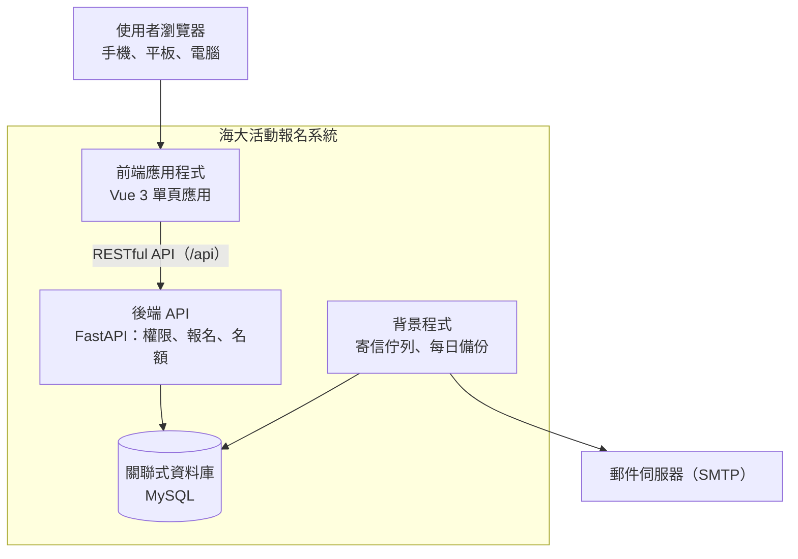
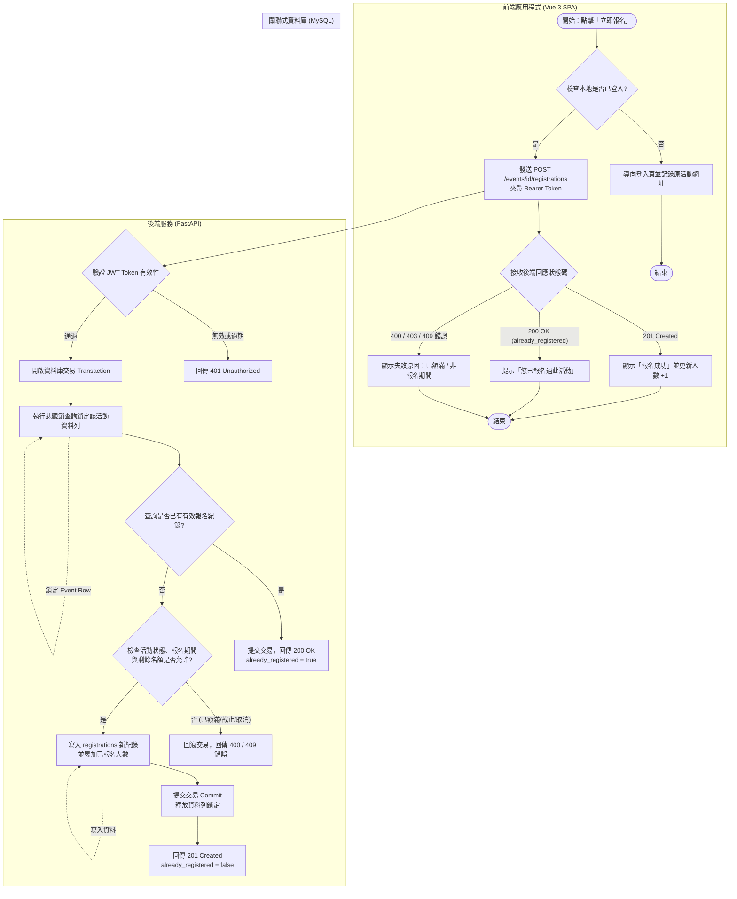
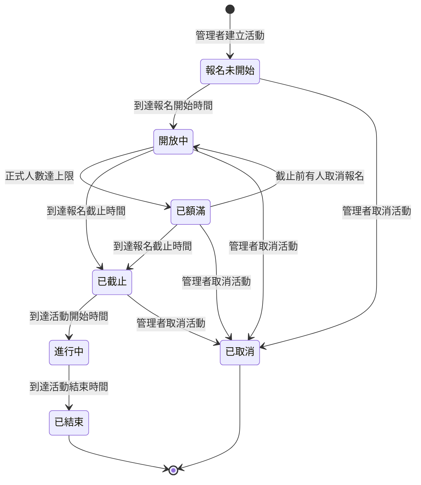
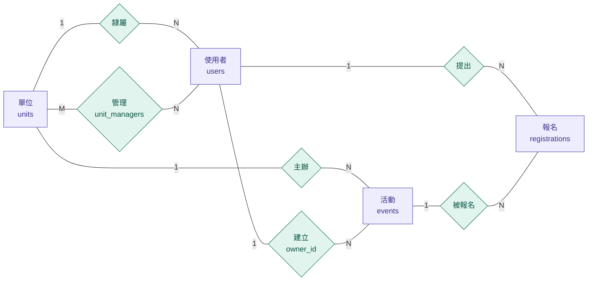
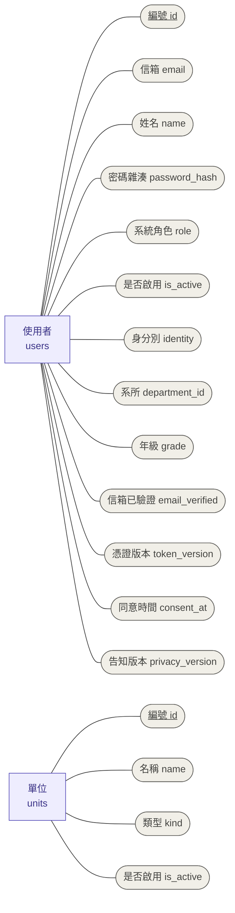
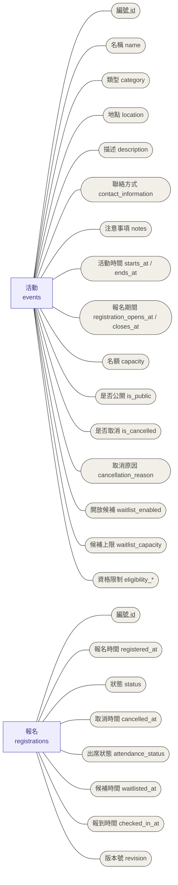
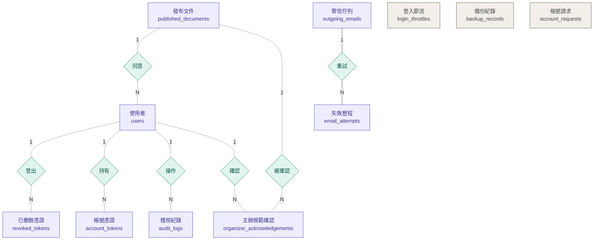
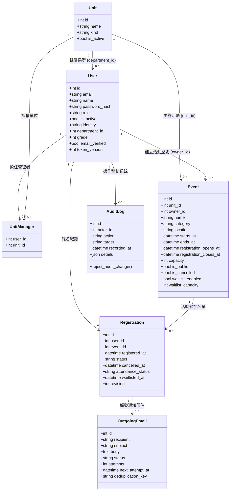

# 軟體設計文件 (SDD)

## 專案資訊

- **專案名稱**：海大活動報名系統
- **對應需求文件版本**：SRD v0.4 / v0.5
- **撰寫日期**：2026/11/16
- **發展者**：柯岳昇、王冠閔、黃俊捷、高揚、蔡承翰

---

## 版次變更記錄

| 版次 | 變更項目 | 變更日期 |
| :-: | :-- | :-: |
| 0.1 | 建立初版 | 2026/11/16 |
| 0.2 | 補齊介面需求與設計中 API | 2026/11/23 |

---

## 目錄

1. 系統模型與架構 (System Model / System Architecture)
2. 介面需求與設計 (Interface Requirement and Design)
3. 流程設計 (Process Design)
4. 使用者畫面設計 (User Interface Design)
5. 資料設計 (Data Design)
6. 類別圖設計 (Class Diagram)
7. 實作方案 (Implementation Languages and Platforms)
8. 設計議題 (Design Issue)

---

## 1. 系統模型與架構 (System Model / System Architecture)

### 架構模式與設計概念

#### 高階架構風格與設計原則

本系統採用前後端分離架構，並遵循以下軟體設計原則：
 * 單頁應用與無狀態 API：
    - 前端負責畫面渲染、表單互動與狀態呈現
    - 後端專注於身分驗證、權限控管、名額併發控制與商業邏輯運算
    - 前後端透過標準化的 JSON over HTTPS 進行通訊，使兩端團隊能依據 API 合約並行開發與獨立部署

 * 分層架構思維：
後端內部邏輯劃分為：
   1. API 路由層 (處理 HTTP 請求與 Pydantic 格式驗證)
   2. 商業邏輯層 (處理報名、候補與排程規則) 
   3. 資料存取層 (透過 ORM 操作資料庫)，確保各層職責單一。

 * 高凝聚力、低耦合力：
依業務領域將系統切分為帳號權限、活動管理、報名控管與非同步寄信佇列等獨立模組。模組間透過明確的介面互動，降低單一功能修改時對整體系統的連鎖衝擊。

#### 技術選型與決策依據

在評估專案開發時程、系統資料特性及團隊現有技術資源後，選定以下技術組合：

 * 前端框架 — Vue 3 + Vite：
本系統包含大量多欄位的建立／編輯活動表單，以及管理後台的高密度名單與權限資料表格。Vue 3 具備直覺的響應式資料雙向綁定 (v-model) 與元件化開發特性，非常適合處理複雜的表單狀態與動態表格渲染；搭配 Vite 建置工具可大幅縮短開發與打包等待時間。

 * 後端框架 — Python (FastAPI)：
團隊成員對 Python 語法具備較良好的掌握度，且 FastAPI 內建的 Pydantic 模型能自動執行嚴格的請求參數與型別防呆，並自動生成互動式 API 文件 (Swagger UI)，大幅降低前後端對接的溝通成本，同時支援非同步處理以應對外部寄信與查詢任務。

 * 關聯式資料庫 — MySQL：
系統中的「使用者、單位、活動、報名紀錄與寄信佇列」具有高度結構化與嚴格的多對多關聯性，且熱門活動報名需依賴關聯式資料庫的交易機制 (ACID 與資料列鎖定) 來防止超賣。

### 系統架構圖



### C4 Model 架構視圖

Level 1: System Context Diagram


Level 2: Container Diagram


Level 3: Component Diagram


---

## 2. 介面需求與設計 (Interface Requirement and Design)

### 介面邊界定義

 * 內部介面：前端 Vue SPA 與後端 FastAPI 之間的 RESTful API 溝通 (統一採用 JSON 格式、Bearer Token 驗證)。
 * 外部介面：後端與校內 / 外部 SMTP 郵件伺服器的溝通介面。

### 全系統介面總攬表

<!-- 不使用 markdown 語法為了方便編輯、修改 -->

<table style="white-space: nowrap;">
    <tr style="background-color: #303036; text-align: center; font-weight: bold;">
        <td>介面名稱</td>
        <td>介面提供者</td>
        <td>介面使用者</td>
        <td>連結方式<br />(Method & URL)</td>
        <td>輸入資料</td>
        <td>輸出資料</td>
        <td>介面描述</td>
    </tr>
    <tr>
        <td>UI-01. 網頁互動介面</td>
        <td>網頁前端 (Vue 3 SPA)</td>
        <td>訪客、一般使用者、管理者</td>
        <td>HTTPS</td>
        <td>瀏覽器點擊、搜尋條件、表單輸入</td>
        <td>HTML / CSS / JS 渲染畫面</td>
        <td>提供活動探索、報名、活動管理<br />與後台維護之圖形化操作入口</td>
    </tr>
    <tr>
        <td>EXT-01. 郵件發送介面</td>
        <td>校園 / 外部 SMTP 伺服器</td>
        <td>背景工作程式<br />(Python Worker)</td>
        <td>SMTP (TLS)</td>
        <td>收件人信箱、主旨、信件內文</td>
        <td>SMTP 寄送狀態碼</td>
        <td>將 Outbox 佇列中之驗證信、<br />重設密碼與活動異動通知寄出</td>
    </tr>
    <tr>
        <td>II-01. 系統健康檢查</td>
        <td>後端API (Default)</td>
        <td>網頁前端 / 維運監控</td>
        <td>GET /</td>
        <td>無</td>
        <td>系統運行訊息 (message)</td>
        <td>確認後端 API 服務是否正常啟動與連線</td>
    </tr>
    <tr>
        <td>II-02. 登入驗證與個人資訊</td>
        <td>後端 API (登入模組)</td>
        <td>網頁前端 (Vue 3 SPA)</td>
        <td>
            <ul>
                <li>POST /auth/login</li>
                <li>POST /auth/logout</li>
                <li>POST /auth/me</li>
            </ul>
        </td>
        <td>LoginRequest (email, password)、<br />Bearer Token</td>
        <td>TokenResponse、<br />UserResponse<br />(含角色與 managed_units)</td>
        <td>核發 JWT 憑證、<br />登入失敗 5 次鎖定 10 分鐘、<br />撤銷 Token 登出及取得當前帳號權限</td>
    </tr>
    <tr>
        <td>II-03. 帳號註冊與密碼重設</td>
        <td>後端 API (帳號模組)</td>
        <td>網頁前端 (Vue 3 SPA)</td>
        <td>
            <ul>
                <li>POST /auth/register</li>
                <li>POST /auth/verify-email</li>
                <li>POST /auth/resend-verification</li>
                <li>POST /auth/forgot-password</li>
                <li>POST /auth/reset-password</li>
            </ul>
        </td>
        <td>SignupRequest、<br />TokenRequest、<br />EmailRequest、<br />ResetPasswordRequest</td>
        <td>建立成功狀態或提示訊息</td>
        <td>限制學校信箱註冊、<br />寄發與驗證一次性信箱驗證連結<br />及忘記密碼重設連結</td>
    </tr>
    <tr>
        <td>II-04. 公開活動瀏覽與查詢</td>
        <td>後端 API (活動模組)</td>
        <td>網頁前端 (Vue 3 SPA)</td>
        <td>
            <ul>
                <li>GET /event-types</li>
                <li>GET /events</li>
                <li>GET /events/{event_id}</li>
            </ul>
        </td>
        <td>關鍵字、類型、<br />日期區間、活動 event_id、<br />選用 Bearer Token</td>
        <td>EventTypeResponse、<br />EventResponse 陣列或名單明細</td>
        <td>供訪客與登入者瀏覽活動列表與詳情；<br />若已登入則同步回傳個人報名狀態<br />與 can_register</td>
    </tr>
    <tr>
        <td>II-05. 建立活動</td>
        <td>後端 API (活動模組)</td>
        <td>網頁前端 (Vue 3 SPA)</td>
        <td>
            <ul>
                <li>POST /events</li>
            </ul>
        </td>
        <td>Bearer Token、EventCreate<br />(名稱、類型、時間、<br />地點、名額、unit_id)</td>
        <td>EventResponse (HTTP 201)</td>
        <td>驗證操作者具備目標 unit_id <br />管理權限且已確認主辦規範，<br />並檢查時間順序防呆</td>
    </tr>
    <tr>
        <td>II-06. 活動管理與名單海報</td>
        <td>後端 API (活動管理模組)</td>
        <td>網頁前端 (Vue 3 SPA)</td>
        <td>
            <ul>
                <li>GET /manage/events</li>
                <li>PATCH /events/{event_id}</li>
                <li>POST /events/{event_id}/cancel</li>
                <li>GET /events/{event_id}/registrations</li>
                <li>GET /events/{event_id}/qr</li>
            </ul>
        </td>
        <td>Bearer Token、event_id、<br />EventUpdate、<br />CancelEventRequest</td>
        <td>可管理活動清單、<br />更新結果、報名名單 (Roster)、<br />活動分享 QR Code</td>
        <td>供活動管理者編輯或<br />取消所屬單位活動 (自動觸發通知信)、<br />檢視報名名單及產生海報 QR Code</td>
    </tr>
    <tr>
        <td>II-07. 活動報名與取消</td>
        <td>後端 API (報名模組)</td>
        <td>網頁前端 (Vue 3 SPA)</td>
        <td>
            <ul>
                <li>POST /events/{event_id}/registrations</li>
                <li>DELETE /events/{event_id}/registrations/me</li>
            </ul>
        </td>
        <td>Bearer Token、event_id</td>
        <td>RegistrationResponse<br />CancellationResponse</td>
        <td>透過資料庫悲觀鎖執行高併發報名<br />防超賣與冪等處理，<br />並支援截止前取消報名釋出名額</td>
    </tr>
    <tr>
        <td>II-08. 個人活動與歷史紀錄</td>
        <td>後端 API (個人活動模組)</td>
        <td>網頁前端 (Vue 3 SPA)</td>
        <td>
            <ul>
                <li>GET /me/events</li>
                <li>GET /me/events/history</li>
            </ul>
        </td>
        <td>Bearer Token</td>
        <td>MyEventResponse 清單</td>
        <td>查詢當前登入者「即將參加」與<br />「過去參與」之活動及出席狀態</td>
    </tr>
    <tr>
        <td>II-09. 單位與系所清單查詢</td>
        <td>後端 API (單位模組)</td>
        <td>網頁前端 (Vue 3 SPA)</td>
        <td>
            <ul>
                <li>GET /departments</li>
                <li>GET /units</li>
            </ul>
        </td>
        <td>無 (公開讀取)</td>
        <td>UnitResponse 清單</td>
        <td>提供註冊時選擇所屬系所，<br />以及首頁篩選或活動查詢時<br />取得公開單位清單</td>
    </tr>
    <tr>
        <td>II-10. 規範文件與確認紀錄</td>
        <td>後端 API (文件模組)</td>
        <td>網頁前端 (Vue 3 SPA)</td>
        <td>
            <ul>
                <li>GET /privacy-notice</li>
                <li>GET /organizer-terms</li>
                <li>GET /faq</li>
                <li>POST /organizer-terms/acknowledgements</li>
            </ul>
        </td>
        <td>Bearer Token、AcknowledgeRequest</td>
        <td>最新版文件內容、確認紀錄</td>
        <td>取得最新版個資告知、主辦規範與 FAQ，<br />並記錄活動管理者勾選確認主辦規範之版本</td>
    </tr>
    <tr>
        <td>II-11. 系統管理後台</td>
        <td>後端 API (系統管理模組)</td>
        <td>網頁前端 (Vue 3 SPA)</td>
        <td>
            <ul>
                <li>GET /admin/users</li>
                <li>PUT /admin/units/{unit_id}/managers/{user_id}</li>
                <li>DELETE /admin/units/{unit_id}/managers/{user_id}</li>
                <li>GET /admin/units</li>
                <li>POST /admin/units</li>
                <li>PUT /admin/units/{unit_id}</li>
                <li>DELETE /admin/units/{unit_id}</li>
                <li>GET /admin/event-types</li>
                <li>POST /admin/event-types</li>
                <li>PUT /admin/event-types/{type_id}</li>
                <li>DELETE /admin/event-types/{type_id}</li>
                <li>POST /admin/documents/{kind}</li>
            </ul>
        </td>
        <td>Bearer Token (限 admin)、<br />UnitRequest、EventTypeRequest、<br />DocumentRequest</td>
        <td>使用者清單、單位與類型資料、<br />發布後之文件版本</td>
        <td>供系統管理員搜尋帳號、<br />指派 / 撤銷單位管理者權限、<br />維護單位與活動類型及發佈新版文件</td>
    </tr>
    <tr>
        <td>II-12. 系統維運與寄信重試</td>
        <td>後端 API (維運模組)</td>
        <td>網頁前端 (Vue 3 SPA)</td>
        <td>
            <ul>
                <li>GET /admin/emails</li>
                <li>POST /admin/emails/{email_id}/retry</li>
                <li>GET /admin/backups</li>
            </ul>
        </td>
        <td>Bearer Token (限 admin)、email_id</td>
        <td>寄信佇列狀態、重試結果、<br />每日備份紀錄</td>
        <td>供系統管理員監控 Outbox 寄信狀態、<br />手動重寄失敗信件及<br />檢視資料庫備份執行歷程</td>
    </tr>
</table>

### 核心 API 詳細規格

#### 1. 使用者登入介面

<table style="white-space: nowrap;">
    <tr style="background-color: #303036; text-align: center; font-weight: bold;">
        <td>介面名稱<br/>(Interface Name)</td>
        <td>介面提供者<br/>(Interface Provider)</td>
        <td>介面使用者<br/>(Interface Consumer)</td>
    </tr>
    <tr>
        <td>使用者登入介面</td>
        <td>後端 API 模組 (FastAPI Application)</td>
        <td>海大活動報名系統 Web 前端 (Vue 3 SPA)</td>
    </tr>
    <tr style="background-color: #303036; text-align: center; font-weight: bold;">
        <td>連結方式</td>
        <td>輸入資料 (參數範例)</td>
        <td>輸出資料 (JSON 範例)</td>
    </tr>
    <tr style="vertical-align: top;">
        <td>HTTP POST <br /> URL: /auth/login</td>
        <td>
            標頭： <br />
            <ul>
                <li>Content-Type: application/json</li>
                <li>Accept：application/json</li>
            </ul>
            請求主體：
            <pre style="font-family: consolas;">
json
{
  "email": "student@email.ntou.edu.tw",
  "password": "Password123"
}</pre>
            </td>
        <td>
            HTTP 200 OK (登入成功)
            <pre style="font-family: consolas;">
json
{
  "access_token": "eyJhbGciOi...",
  "token_type": "bearer",
  "expires_in": 3600,
  "user": {
    "id": 1,
    "email": "student@email.ntou.edu.tw",
    "name": "田索浩二",
    "role": "member",
    "identity": "student",
    "department": {
      "id": 1,
      "name": "資訊工程學系"
    },
    "grade": 3,
    "managed_units": []
  }
}</pre>
             HTTP 401 Unauthorized (驗證失敗)
            <pre style="font-family: consolas;">
json
{
  "detail": {
    "code": "INVALID_CREDENTIALS",
    "message": "帳號或密碼錯誤"
  }
}</pre>
            HTTP 422 Validation Error (格式錯誤)
            <pre style="font-family: consolas;">
json
{
  "detail": [
    {
      "loc": [
        "string",
        0
      ],
      "msg": "string",
      "type": "string",
      "input": "string",
      "ctx": {}
    }
  ]
}</pre>
        </td>
    </tr>
    <tr>
        <td colspan="3">對應介面描述</td>
    </tr>
    <tr>
        <td colspan="3">
            <ol>
                <li>介面功能與目的：</li>
                驗證使用者輸入之學校信箱與密碼，核發 Bearer Access Token 並回傳基本個人資料與可管理單位清單 (managed_units)
                <li>狀態碼與防呆機制：</li>
                <ul>
                    <li>錯誤模糊化：帳號不存在或密碼錯誤皆統一回傳 401 Unauthorized (帳號或密碼錯誤)，避免洩漏帳號註冊狀態</li>
                    <li>連續失敗鎖定：同一信箱連續登入失敗達 5 次將鎖定帳號 10 分鐘 (對應 SRD NFR-05-04) </li>
                    <li>信箱驗證檢查：尚未完成信箱驗證之帳號無法登入 (對應 SRD FR-01-02)</li>
                    <li>快取防護：回應標頭強制帶上 `Cache-Control`，避免 Token 殘留於瀏覽器快取</li>
                </ul>
            </ol>
        </td>
    </tr>
</table>

#### 2. 建立活動介面

<table style="white-space: nowrap;">
    <tr>
        <td style="text-align: center;"><b>介面名稱<br/>(Interface Name)</b></td>
        <td style="text-align: center;"><b>介面提供者<br/>(Interface Provider)</b></td>
        <td style="text-align: center;"><b>介面使用者<br/>(Interface Consumer)</b></td>
    </tr>
    <tr>
        <td>建立活動介面</td>
        <td>後端 API 模組 (FastAPI Application)</td>
        <td>海大活動報名系統 Web 前端 (Vue 3 SPA)</td>
    </tr>
    <tr>
        <td style="text-align: center;"><b>連結方式</b></td>
        <td style="text-align: center;"><b>輸入資料 (參數範例)</b></td>
        <td style="text-align: center;"><b>輸出資料 (JSON 範例)</b></td>
    </tr>
    <tr style="vertical-align: top;">
        <td>HTTP POST <br /> URL: /events</td>
        <td>
            標頭： <br />
            <ul>
                <li>Authorization：Bearer &lt;access_token&gt;</li>
                <li>Content-Type: application/json</li>
                <li>Accept：application/json</li>
            </ul>
            請求主體：
            <pre style="font-family: consolas;">
json
{
  "name": "資工系企業參訪",
  "type": "參訪",
  "description": "參訪知名科技研發中心",
  "location": "INS 203 教室集合",
  "contact_information": "cs@ntou.edu.tw",
  "start_time": "2026-12-01T13:10:00Z",
  "end_time": "2026-12-01T16:00:00Z",
  "registration_start": "2026-11-20T09:00:00Z",
  "registration_deadline": "2026-11-28T18:00:00Z",
  "capacity": 40,
  "unit_id": 1,
  "notes": "請準時集合並攜帶學生證與紙筆"
}</pre>
            </td>
        <td>
            HTTP 201 Created (建立成功)
            <pre style="font-family: consolas;">
json
{
  "id": 15,
  "name": "資工系企業參訪",
  "type": "參訪",
  "unit_id": 1,
  "unit": {
    "id": 1,
    "name": "資訊工程學系"
  },
  "contact_information": "cs@ntou.edu.tw",
  "start_time": "2026-12-01T13:10:00Z",
  "end_time": "2026-12-01T16:00:00Z",
  "registration_start": "2026-11-20T09:00:00Z",
  "registration_deadline": "2026-11-28T18:00:00Z",
  "registration_count": 0,
  "category": "參訪",
  "location": "INS 203 教室集合",
  "description": "參訪知名科技研發中心",
  "notes": "請準時集合並攜帶學生證與紙筆",
  "starts_at": "2026-12-01T13:10:00Z",
  "ends_at": "2026-12-01T16:00:00Z",
  "registration_opens_at": "2026-11-20T09:00:00Z",
  "registration_closes_at": "2026-11-28T18:00:00Z",
  "capacity": 40,
  "registered_count": 0,
  "waitlist_count": 0,
  "status": "報名未開始",
  "my_registration_status": null,
  "can_register": false,
  "cancellation_reason": null
}</pre>
            HTTP 422 Validation Error (驗證失敗)
            <pre style="font-family: consolas;">
json
{
  "detail": [
    {
      "loc": [
        "string",
        0
      ],
      "msg": "string",
      "type": "string",
      "input": "string",
      "ctx": {}
    }
  ]
}</pre>
        </td>
    </tr>
    <tr>
        <td colspan="3">對應介面描述</td>
    </tr>
    <tr>
        <td colspan="3">
            <ol>
                <li>介面功能與目的：</li>
                提供具備活動管理者權限之使用者，以所屬單位 (unit_id) 名義建立新活動 (對應 SRD FR-03-01)
                <li>身分驗證與單位權限規則：</li>
                <ul>
                    <li>請求必須帶有有效之 Bearer Token，若未登入回傳 401 Unauthorized</li>
                    <li>後端會驗證該使用者是否具備目標 unit_id 之管理權限，以及是否已勾選確認最新版本之主辦規範 (SRD FR-03-14)。若無該單位權限則回傳 403 Forbidden</li>
                </ul>
                <li>資料與時間防呆機制：</li>
                <ul>
                    <li>必填欄位檢查：活動名稱、類型、描述、地點、聯絡資訊、活動起訖時間、報名起訖時間與主辦單位不可為空 (名額上限 capacity 留空代表不限名額)</li>
                    <li>時間順序驗證：後端嚴格檢查「活動結束時間晚於開始時間」、「報名截止時間不晚於活動開始時間」且「報名開始時間早於截止時間」 (對應 SRD FR-03-02)，任一違反即攔截並回傳 422 Validation Error </li>
                </ul>
            </ol>
        </td>
    </tr>
</table>

#### 3. 活動報名介面

<table style="white-space: nowrap;">
    <tr>
        <td style="text-align: center;"><b>介面名稱<br/>(Interface Name)</b></td>
        <td style="text-align: center;"><b>介面提供者<br/>(Interface Provider)</b></td>
        <td style="text-align: center;"><b>介面使用者<br/>(Interface Consumer)</b></td>
    </tr>
    <tr>
        <td>活動報名介面</td>
        <td>後端 API 模組 (FastAPI Application)</td>
        <td>海大活動報名系統 Web 前端 (Vue 3 SPA)</td>
    </tr>
    <tr>
        <td style="text-align: center;"><b>連結方式</b></td>
        <td style="text-align: center;"><b>輸入資料 (參數範例)</b></td>
        <td style="text-align: center;"><b>輸出資料 (JSON 範例)</b></td>
    </tr>
    <tr style="vertical-align: top;">
        <td>HTTP POST <br /> URL: /events/[event_id]/registrations</td>
        <td>
            路徑參數：<br />
            <ul><li>event_id (integer, required)：活動唯一識別碼</li></ul>
            標頭： <br />
            <ul>
                <li>Authorization：Bearer &lt;access_token&gt</li>
                <li>Accept：application/json</li>
            </ul>
            請求主體： <br />
            無 (Empty Body或 -d '') <br/>
            </td>
        <td>
            HTTP 201 Created (首次報名成功) <br />
            HTTP 200 OK (已報名過) (以下為重複報名之回應)
            <pre style="font-family: consolas;">
json
{
  "message": "報名成功",
  "registration_id": 108,
  "event_id": 2,
  "status": "registered",
  "registered_at": "2026-11-11T14:30:44.229Z",
  "registration_status": "已報名",
  "registered_count": 45,
  "registration_count": 45,
  "capacity": 50,
  "already_registered": true
}</pre>
            HTTP 422 Validation Error (參數錯誤)
            <pre style="font-family: consolas;">
json
{
  "detail": [
    {
      "loc": [
        "string",
        0
      ],
      "msg": "string",
      "type": "string",
      "input": "string",
      "ctx": {}
    }
  ]
}</pre>
        </td>
    </tr>
    <tr>
        <td colspan="3">對應介面描述</td>
    </tr>
    <tr>
        <td colspan="3">
            <ol>
                <li>介面功能與目的：</li>
                提供已登入之一般使用者 (學生 / 教師 / 行政人員) 針對指定活動 (event_id) 送出報名請求
                <li>身分驗證與權限規則：</li>
                請求必須帶有有效之 Bearer Token (由後端依賴項 required_user 驗證)，若未帶或已過期，後端回傳 401 Unauthorized
                <li>狀態碼與防呆機制：</li>
                <ul>
                    <li>首次報名成功：若尚未報名且名額允許，後端建立報名紀錄並回傳 HTTP 201 Created，系統累加 registered_count</li>
                    <li>重複報名處理：若該使用者先前已完成報名，後端不拋出例外，而是回傳 HTTP 200 OK，同時回傳欄位 "already_registered": true，供前端提示使用者已完成報名，避免重複寫入</li>
                    <li>參數驗證：若 event_id 型別不符 (例如傳入字串)，系統自動攔截並回傳 HTTP 422 Validation Error</li>
                </ul>
            </ol>
        </td>
    </tr>
</table>

---

## 3. 流程設計 (Process Design)

以 UML 活動圖與狀態轉換圖 (State Transition Diagram) 呈現系統的核心動態運作邏輯，包含「高併發活動報名與防超賣交易流程」以及「活動生命週期狀態轉換」。

### 核心活動報名與防超賣流程

此流程展示使用者點擊報名後，前端、後端 API 與 MySQL 資料庫如何透過交易悲觀鎖 (SELECT ... FOR UPDATE) 協同運作，確保名額不超賣且防止重複報名：



### 活動狀態轉換圖

活動狀態主要由伺服器時間與報名人數自動驅動，僅「已取消」由活動管理者手動觸發：



---

## 4. 使用者畫面設計 (User Interface Design)

畫面一：網頁主頁


畫面二：活動詳情頁


畫面三：個人活動管理


畫面四：活動建立者建立活動


畫面五：活動建立者活動管理


畫面六：系統管理員系統管理


---

## 5. 資料設計 (Data Design)

### 5.1 資料庫 Schema

#### 實體關聯圖 (ERD)

1. 核心實體與關聯


2. 使用者與單位的屬性


3. 活動與報名的屬性


4. 輔助資料表 (虛線為還需研議)


#### 資料表綱要

本系統資料庫採用 MySQL (InnoDB 引擎、utf8mb4 編碼)。以下列出核心業務資料表之欄位定義與約束條件：

1. 使用者資料表 (users)
儲存全校師生、訪客註冊帳號、身分屬性及個資同意紀錄

|欄位名稱|資料型別|鍵值 / 約束條件|說明|
|--|--|--|--|
|`id`|INT|`PK`|使用者唯一識別碼|
|`email`|VARCHAR(254)|`UNIQUE`, `NOT NULL`|學校信箱 (登入帳號)|
|`name`|VARCHAR(100)|`NOT NULL`|使用者姓名|
|`password_hash`|VARCHAR(255)|`NOT NULL`|加鹽雜湊後之密碼|
|`role`|VARCHAR(20)|`DEFAULT 'member'`, `CHECK`|系統角色 (member / manager / admin)
|`is_active`|BOOLEAN|`DEFAULT TRUE`|帳號是否啟用 (停用控管)|
|`identity`|VARCHAR(20)|`NULL`, `CHECK`|身分別 (student / teacher / staff)|
|`department_id`|INT|`FK (units.id)`, `NULL`|所屬系所／單位 ID|
|`grade`|INT|`NULL`|年級 (身分別為學生時填寫)|
|`email_verified`|BOOLEAN|`DEFAULT FALSE`|信箱是否已完成驗證|
|`token_version`|INT|`DEFAULT 0`|憑證版本號 (重設密碼時遞增以使舊登入失效)|
|`consent_at`|DATETIME|`NULL`|同意個資告知事項之時間戳記|
|`privacy_version`|INT|`NULL`|同意之個資告知事項版本號| 

2. 單位資料表 (units)、單位管理者關聯表(unit_managers)
實現「活動歸屬於單位而非個人」以及「一位管理者可跨多單位」的多對多權限設計

 * 單位資料表
 
|欄位名稱|資料型別|鍵值 / 約束條件|說明|
|--|--|--|--|
|`id`|INT|`PK`|單位唯一識別碼|
|`name`|VARCHAR(100)|`NOT NULL`|單位名稱 (系所、行政單位或社團名)|
|`kind`|VARCHAR(20)|`DEFAULT 'department'`, `CHECK`|單位類型 (department / office / club)|
|`is_active`|BOOLEAN|`DEFAULT TRUE`|單位是否啟用| 

 * 單位管理者關聯表

|欄位名稱|資料型別|鍵值 / 約束條件|說明|
|--|--|--|--|
|`user_id`|INT|`PK`, `FK (users.id)`|活動管理者帳號 ID|
|`unit_id`|INT|`PK`, `FK (units.id)`, `INDEX`|授權管理之單位 ID|

3. 活動資料表 (events)
儲存活動基本資訊、報名區間、名額與候補設定，並透過資料庫 CHECK 約束確保時間邏輯正確

|欄位名稱|資料型別|鍵值 / 約束條件|說明|
|--|--|--|--|
|`id`|INT|`PK`|活動唯一識別碼|
|`unit_id`|INT|`FK (units.id)`, `INDEX`|主辦單位 ID (權限判斷依據)|
|`owner_id`|INT|`FK (users.id)`|原始建立者 ID (僅作歷史紀錄保留)|
|`name`|VARCHAR(200)|`NOT NULL`|活動名稱|
|`category`|VARCHAR(100)|`NOT NULL`|活動類型名稱|
|`location`|VARCHAR(255)|`NOT NULL`|活動地點|
|`description`|TEXT|`NOT NULL`|活動詳細描述|
|`contact_information`|VARCHAR(255)|`NOT NULL`|主辦單位聯絡方式|
|`notes`|TEXT|NULL|活動注意事項|
|`starts_at` / `ends_at`|DATETIME|`INDEX`, `CHECK`|活動起訖時間 (約束：ends_at > starts_at)
|`registration_opens_at` / `closes_at`|DATETIME|`CHECK`|報名起訖時間 (約束：opens < closes <= starts)
|`capacity`|INT|`NULL`, `CHECK`|名額上限 (NULL 為不限；否則須 > 0)|
|`is_public`|BOOLEAN|`DEFAULT TRUE`|是否公開顯示於首頁|
|`is_cancelled`|BOOLEAN|`DEFAULT FALSE`|是否已取消活動|
|`cancellation_reason`|TEXT|`NULL`|取消原因 (取消時填寫)|
|`waitlist_enabled`|BOOLEAN|`DEFAULT FALSE`|是否開放候補名單 (R3 擴充欄位)|
|`waitlist_capacity`|INT|`NULL`|候補人數上限 (R3 擴充欄位)|
|`eligibility_*`|JSON|`DEFAULT []`|資格限制清單 (含身分別、系所、年級 JSON 陣列)|

4. 報名紀錄資料表 (registrations)
記錄使用者報名、候補與出席狀態，並透過唯一鍵防止重複報名。

|欄位名稱|資料型別|鍵值 / 約束條件|說明|
|--|--|--|--|
|`id`|INT|`PK`|報名紀錄唯一識別碼|
|`user_id`|INT|`FK (users.id)`, `UNIQUE(user, event)`|報名者 ID (與 event_id 組成複合唯一鍵)|
|`event_id`|INT|`FK (events.id)`, `INDEX`|活動 ID|
|`registered_at`|DATETIME|`NOT NULL`|報名送出時間|
|`status`|VARCHAR(20)|`DEFAULT 'registered'`, `INDEX`, `CHECK`|報名狀態 (registered / cancelled / waitlisted / not_promoted)|
|`cancelled_at`|DATETIME|`NULL`|取消報名時間|
|`attendance_status`|VARCHAR(20)|`DEFAULT 'unrecorded'`, `CHECK`|出席狀態 (unrecorded / present / absent / leave)|
|`waitlisted_at`|DATETIME|`NULL`|加入候補之時間戳記 (候補排序依據)|
|`checked_in_at`|DATETIME|`NULL`|現場報到時間|
|`revision`|INT|`DEFAULT 0`|紀錄版本號 (防止重複排程通知)|

5. 非同步寄信佇列表 (outgoing_emails) 、輔助資料表總覽
為了確保信件發送可靠性與系統稽核，資料庫另包含以下輔助資料表：

|資料表名稱|主要用途與設計亮點|
|--|--|
|`outgoing_emails`|**寄信 Outbox 佇列**：儲存收件人、主旨、內文、`status、attempts` (重試次數)、`next_attempt_at` (下次重試時間)、`deduplication_key` (防止重複發信之唯一鍵)|
|`email_attempts`|**寄信失敗歷程**：記錄每次寄信失敗的時間與錯誤訊息 (關聯 `outgoing_emails.id`)|
|`account_tokens` / `account_requests`|**驗證與重設憑證**：僅儲存 Token 雜湊值 (`token_hash`) 與冷卻時間，避免資料庫明文外洩連結|
|`revoked_tokens` / `login_throttles`|**安全控管**：記錄已登出之 JWT (`jti`) 確保立即失效，以及登入失敗次數 (`failed_count`) 執行 5 次鎖定 10 分鐘規則|
|`published_documents` / `organizer_acknowledgements`|**法遵與規範版本控管**：儲存個資告知、主辦規範與 FAQ 的不可變版本，並記錄管理者確認時間|
|`backup_records` / `audit_logs`|維運與不可竄改稽核：記錄每日備份結果；`audit_logs` 透過 ORM 事件攔截 `UPDATE` 與 `DELETE`，強制維持 Append-only (僅可新增) 特性|

### 5.2 檔案結構

```
📂 ntou-event/
├── 📂 backend/                        # 後端服務 (Python FastAPI)
│   ├── 📂 app/                        # 核心應用程式模組
│   │   ├── 📄 api.py                  # RESTful API 路由定義與請求處理
│   │   ├── 📄 config.py               # 系統環境參數與設定載入
│   │   ├── 📄 database.py             # SQLAlchemy 資料庫連線與 Session 管理
│   │   ├── 📄 models.py               # MySQL ORM 資料表模型與資料庫約束定義
│   │   ├── 📄 schemas.py              # Pydantic 請求與回應資料驗證模型
│   │   ├── 📄 security.py             # 密碼加鹽雜湊 (bcrypt) 與 JWT Token 驗證
│   │   ├── 📄 services.py             # 核心商業邏輯 (報名名額鎖定、活動管理、權限檢查)
│   │   ├── 📄 operations.py           # 非同步寄信 Outbox 佇列與每日備份維運邏輯
│   │   └── 📄 site.py                 # 系統公告、FAQ 與規範文件管理邏輯
│   ├── 📂 docs/                       # 資料庫初始化 SQL 與開發交接文件
│   ├── 📂 scripts/                    # 系統壓力測試腳本 (load_test_mvp.py)
│   ├── 📂 tests/                      # 自動化單元與整合測試套件 (含 MySQL 併發與驗收測試)
│   ├── 📄 compose.yaml                # Docker Compose 資料庫容器部署設定
│   ├── 📄 init_db.py / init_data.py   # 資料庫建表與系統管理員/測試資料初始化腳本
│   ├── 📄 main.py                     # FastAPI Web 伺服器啟動入口
│   ├── 📄 worker.py                   # 背景排程工作程序 (處理寄信佇列與自動備份)
│   └── 📄 requirements.txt            # 後端 Python 相依套件清單
│
└── 📂 frontend/                       # 前端單頁應用程式 (Vue 3 + Vite)
    ├── 📂 src/
    │   ├── 📂 components/             # 共用 UI 元件
    │   │   ├── 📂 admin/              # 系統管理後台子元件 (使用者、單位、類型、寄信、備份管理)
    │   │   ├── 📄 EventCard.vue       # 活動列表卡片元件
    │   │   ├── 📄 EventForm.vue       # 建立與編輯活動共用表單元件
    │   │   ├── 📄 Navbar.vue          # 全域導覽列 (依登入與管理角色動態切換入口)
    │   │   ├── 📄 OrganizerermPanel.vue # 活動管理者單位操作面板
    │   │   └── 📄 ResendVerification.vue # 重新寄送驗證信元件
    │   ├── 📂 router/
    │   │   └── 📄 index.js            # Vue Router 前端路由與登入/權限導頁守衛
    │   ├── 📂 views/                  # 頁面級視圖 (Views)
    │   │   ├── 📄 Home.vue            # 首頁 (活動探索、關鍵字搜尋與類型/日期篩選)
    │   │   ├── 📄 EventDetail.vue     # 活動詳情與報名/分享 QR Code 頁面
    │   │   ├── 📄 Login.vue / Register.vue / VerifyEmail.vue # 登入、註冊與信箱驗證頁面
    │   │   ├── 📄 ForgotPassword.vue / ResetPassword.vue     # 忘記與重設密碼頁面
    │   │   ├── 📄 MyEvents.vue        # 個人專區 (即將參加、取消報名與歷史紀錄)
    │   │   ├── 📄 CreateEvent.vue / EditEvent.vue / ManageEvents.vue # 活動建立與管理頁面
    │   │   ├── 📄 Roster.vue          # 活動報名名單檢視頁面
    │   │   ├── 📄 OrganizerTerms.vue  # 主辦規範閱讀與確認頁面
    │   │   ├── 📄 Admin.vue           # 系統管理員後台主頁面
    │   │   └── 📄 Faq.vue             # 常見問題頁面
    │   ├── 📄 api.js                  # Axios 實例封裝與 Bearer Token 請求攔截器
    │   ├── 📄 auth.js                 # 前端登入狀態與角色權限狀態管理
    │   ├── 📄 eventForm.js / format.js # 表單驗證輔助與日期時間格式化工具
    │   ├── 📄 App.vue                 # 根元件 (全域版面外框)
    │   └── 📄 main.js                 # Vue 應用程式掛載入口
    ├── 📄 index.html                  # SPA HTML 入口頁面
    ├── 📄 package.json                # 前端專案設定與 npm 套件清單
    └── 📄 vite.config.js              # Vite 建置與開發伺服器代理設定
```

### 5.3 XML / JSON 結構

本系統採用 RESTful API 進行前後端資料交換，傳輸格式統一為 `application/json`（UTF-8 編碼）。以下定義系統中最核心的三種 JSON 資料物件結構：

#### 1. 活動資料物件 (Event Object)
用於首頁活動列表 (`GET /events`) 與活動詳情頁 (`GET /events/{event_id}`) 之資料呈現：

```json
{
  "id": 2,
  "name": "軟體工程期末專案分享會",
  "type": "講座",
  "unit": {
    "id": 1,
    "name": "資訊工程學系"
  },
  "location": "INS 201",
  "start_time": "2026-11-25T18:30:00Z",
  "end_time": "2026-11-25T20:30:00Z",
  "registration_count": 45,
  "capacity": 50,
  "status": "開放中",
  "my_registration_status": "未報名",
  "can_register": true
}
```
關鍵欄位設計說明：
 * unit 採用巢狀物件 (Nested Object) 同時回傳單位 id 與 name，減少前端額外查詢
 * status 與 can_register 由後端依伺服器時間與名額即時計算，供前端直接控制按鈕狀態

#### 2. 活動報名回應物件 (Registration Response Object)
用於使用者送出報名請求（`POST /events/{event_id}/registrations`）後，回傳之報名結果與即時名額狀態：

```json
{
  "message": "報名成功",
  "registration_id": 108,
  "event_id": 2,
  "status": "registered",
  "registered_at": "2026-11-11T14:30:44.229Z",
  "registration_status": "已報名",
  "registered_count": 46,
  "capacity": 50,
  "already_registered": false
}
```

關鍵欄位設計說明：
 * already_registered 用於區分「首次報名成功 (false)」與「重複點擊報名 (true)」
 * registered_count 回傳交易鎖定更新後的最新人數，讓前端可即時刷新畫面數字

#### 3. 登入憑證與使用者物件 (Auth Token & User Object)
用於身分驗證成功（POST /auth/login）時，回傳之 JWT 憑證與使用者角色權限資訊：

```json
{
  "access_token": "eyJhbGciOiJIUzI1NiIs...",
  "token_type": "bearer",
  "expires_in": 3600,
  "user": {
    "id": 3,
    "email": "manager@ntou.edu.tw",
    "name": "豐川祥子",
    "role": "manager",
    "identity": "teacher",
    "department": {
      "id": 1,
      "name": "資訊工程學系"
    },
    "grade": null,
    "managed_units": [
      { "id": 1, "name": "資訊工程學系" }
    ]
  }
}
```

關鍵欄位設計說明：
 * 透過 managed_units 陣列直接提供該管理者可操作的單位清單，前端可據此動態渲染導覽列選單與建立活動時的單位下拉選項

---

## 6. 類別圖設計 (Class Diagram)

本系統後端採用 Python FastAPI 框架，API 路由與商業邏輯以模組化函式 (`api.py`、`services.py`、`operations.py`) 實作，核心領域實體結構、欄位約束與關聯關係則透過 SQLAlchemy ORM 類別 (`models.py`) 進行嚴格定義。

以下類別圖呈現系統核心領域模型 (Domain / ORM Models) 及其多重性關聯 (Multiplicity)：



### 核心類別職責說明

 * **`User` & `Unit` & `UnitManager` (帳號與多對多單位權限模型)**：透過中介關聯類別 UnitManager 實現「一位管理者可管理多個單位」與「活動歸屬於單位而非個人」之設計，便於社團或系所幹部交接。
 * **`Event` (活動核心模型)**：內建資料庫層級的時間順序與名額上限檢查約束 (`CheckConstraint`)，並預留 R3 候補 (`waitlist_enabled`) 與資格限制 (`eligibility_*`) 擴充屬性。
 * **`Registration` (報名狀態模型)**：透過 ``(user_id, event_id)`` 複合唯一約束 (`UniqueConstraint`) 從資料庫底層杜絕同一使用者重複報名。
 * **`OutgoingEmail` (非同步維護)**：支援 Outbox 佇列重試與去重鍵 (`deduplication_key`)。
 * **`AuditLog` (不可竄改稽核模型)**：透過 SQLAlchemy 事件監聽器 (`reject_audit_change`) 攔截修改與刪除操作，確保稽核紀錄僅可新增 (Append-only)。

---

## 7. 實作方案 (Implementation Languages and Platforms)

 * **平台**：Web 網頁應用程式 (支援桌面與行動裝置 RWD 瀏覽器)。

 * **前端技術與框架**：HTML5、CSS3、JavaScript (ES6+)、Vue 3 (Composition API)、Vite。

 * **後端技術與框架**：Python 3、FastAPI、Uvicorn (ASGI Server)。

 * **主要函式庫與服務**：前端使用 Vue Router、Axios；後端使用 SQLAlchemy (ORM)、PyMySQL、Pydantic (資料驗證)、Passlib / bcrypt (密碼雜湊)、PyJWT (身分驗證)；資料庫採用 MySQL (InnoDB)；外部整合校內/外部 SMTP 郵件服務。

 * **部署方式**：GitHub 版本控制 (PR 審查機制)，預計部署於雲端 PaaS 平台 (如 Render / Zeabur) 或校內伺服器提供外部 HTTPS 存取。

---

## 8. 設計議題 (Design Issue)

### 議題 1：

 * **議題內容 (Issue)**
熱門活動報名之高併發名額扣減與防超賣機制 (短時間內處理大量請求的方式)
 * **背景 (Context)**
熱門活動開放時會瞬間湧入大量請求，直接頻繁讀寫 MySQL 容易造成資料庫鎖定過久或逾時。但是系統必須嚴格保證報名人數不超過名額上限 (不能超賣)，且目前團隊開發資源有限
 * **考量方案 (Alternatives)** 
    - 方案 A (MySQL 資料庫交易鎖定 / 悲觀鎖)：請求進入時利用資料庫交易依序扣減名額，如此可以保證資料絕對一致，但尖峰時使用者需要排隊等待
    - 方案 B (Redis 快取預扣 + 非同步訊息佇列)：利用 Redis 記憶體快取先瞬間扣掉名額，再將報名資料丟入背景佇列依序寫入 MySQL，速度極快但是系統架構較為複雜
 * **決策與理由 (Decision and Rationale)**
暫定使用方案 A。因為目前專案規模與校園活動人數在單一 MySQL 承受範圍內，此方案能維持現有架構單純性、降低開發與維運成本，且具備最高的資料可靠性
 * **後果 (Consequences)**
若瞬間流量過大，排隊等待鎖定可能導致API回應變慢或請求逾時，後端須設定合理的 Timeout 時間並提供友善的重試提示

### 議題 2：

 * **議題內容 (Issue)**
非同步通知信件發送與失敗重試機制 (系統發送信件時不拖慢前端 API 回應速度、可靠送達的方式)
 * **背景 (Context)**
使用者註冊、活動改期或取消時，系統必須自動寄送 Email 通知相關人員，且在寄信失敗時須自動重試至少 3 次並留存紀錄。然而，直接連線外部 SMTP 伺服器通常需要 1～3 秒的網路等待時間，且可能因網路波動或郵件伺服器限流而失敗；若讓主 API 直接同步等待寄信完成，不僅會造成前端畫面卡頓，甚至可能因寄信失敗而導致活動修改或註冊交易一起失敗
 * **考量方案 (Alternatives)** 
    - 方案 A (API 同步直接寄信 / Synchronous SMTP Call)：在處理註冊或修改活動的 API 請求當下，直接呼叫 SMTP 連線寄信，確認寄出後才回傳成功給前端。實作最直接，但使用者等待時間長，且一旦 SMTP 斷線會直接影響主業務流程
    - 方案 B (資料庫 Outbox 佇列 + 背景 Worker 非同步重試)：主 API 僅在資料庫交易中將待寄信件寫入 `outgoing_emails` 資料表即立刻回傳成功；另由獨立的背景程式 (`worker.py`) 定時撈取待寄信件透過 SMTP 發送，失敗時自動記錄錯誤 (`email_attempts`) 並排程重試最多 3 次。架構多一支背景程序，但能徹底隔離外部服務風險
 * **決策與理由 (Decision and Rationale)**
暫定採用方案 B。因為系統已使用 MySQL 作為核心資料庫，直接利用關聯式資料表作為任務佇列即可實現可靠的非同步寄信與失敗重試，無需額外引入 RabbitMQ 或 Celery 等訊息中介軟體；同時能確保「寫入待寄信件」與「活動異動／帳號建立」在同一個資料庫交易中完成，兼具效能與資料一致性
 * **後果 (Consequences)**
通知信件為近即時 (Near Real-Time) 而非絕對秒級送達，信件發送時間會取決於背景 Worker 的輪詢間隔 (約數秒延遲)
此外，若連續重試 3 次仍失敗，信件將標記為失敗狀態，需依賴系統管理員定期至後台「寄信紀錄」頁面檢視並手動觸發重寄