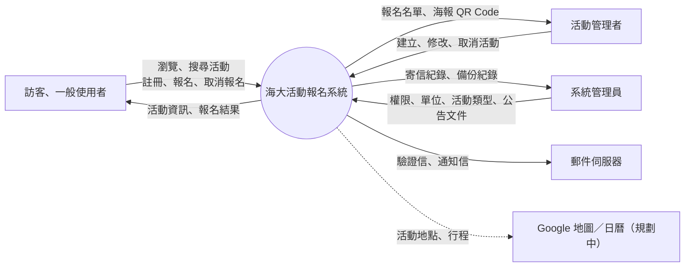
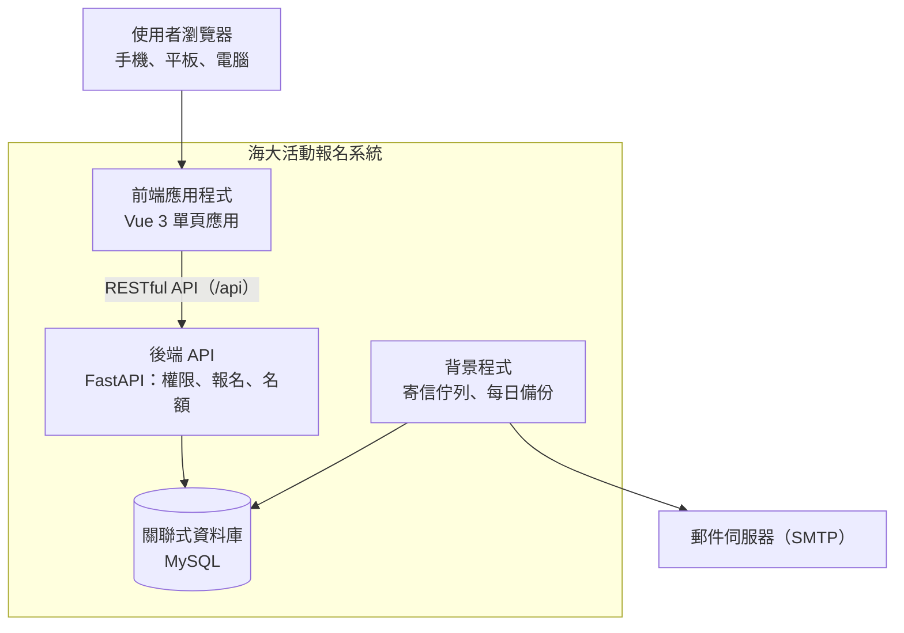

# 軟體需求文件(SRD)

## 專案資訊

- **專案名稱**：海大活動報名系統
- **撰寫日期**：2026/10/7
- **發展者**：柯岳昇、王冠閔、黃俊捷、高揚、蔡承翰

---

## 版次變更記錄

| 版次 | 變更項目 | 變更日期 |
| :-: | :-- | :-: |
| 0.1 | 初版 | 2026/10/7 |
| 0.2 | 加入預計實作方案、使用者地圖 | 2026/10/13 |
| 0.3 | 將使用者地圖更加完善 | 2026/10/19 |
| 0.4 | 釋出版本調整為 MVP／R2／R3、標註測試方法的適用版本、功能與非功能需求對齊使用者故事 | 2026/11/3 |
| 0.5 | C03 時間規則改為嚴格：活動結束須晚於開始、報名開始須早於報名截止（不可相等）；報名截止仍可等於活動開始；A05 測試方法改為「登出後進入需要登入的頁面」；B04 關鍵字擴及地點、類型與主辦單位 (可用簡稱)；A01 行政人員改選行政單位；單位清單依學校官網 | 2026/11/11 |
| 0.6 | 系統概述新增情境圖與概念架構圖 | 2026/11/16 |
| 1.0 |  |  |

---

## 目錄

1. [接受準則（Acceptance Criteria of this document）](#section1)
2. [系統概述（System Description）](#section2)
3. [操作概念（Operational Concepts）](#section3)
4. [使用者故事地圖（User Story Map）](#section4)
5. [使用者介面分析（User Interface Analysis）](#section5)
6. [功能需求（Functional Requirements）](#section6)
7. [非功能需求（Non-functional Requirements）](#section7)

---

## 接受準則 (Acceptance Criteria)

- Clearly and properly stated（需求需清楚且適當的陳述）
- Complete（需求需完整）
- Consistent with each other（需求之間需維持一致性）
- Uniquely identified（每項需求有明確之識別）
- Appropriate to implement（需求需可被實作）
- Verifiable（需求需可被驗證）
- Traceable（需求可追溯至使用者故事與來源）
- Prioritized（需求已標示釋出版本與優先順序）

---

## 系統概述 (System Description)

### 系統目標

本專案旨在為國立臺灣海洋大學開發一套活動報名系統，整合校內單位與學生社團所舉辦的各項活動。系統以單一平台取代分散的紙本與線上表單報名，將活動發布、報名、候補、通知與出席紀錄集中管理，以簡化行政人員與活動管理者的作業流程，並提升全校師生查詢與參與活動的便利性。

### 系統特色

- 多角色權限管理：支援訪客、一般使用者 (學生 / 教師 / 行政人員)、活動管理者與系統管理員等多元角色。
- 名額控管與候補遞補：活動可設定報名人數上限 (或不限名額)。名額已滿時，可依活動設定開放候補；正式報名者取消後，系統依候補順位自動遞補，並確保多人同時報名或取消時，正式人數不超過上限。
- 報名條件檢查：報名時自動檢查報名期間、報名資格 (身分別、系所、年級) 以及與已報名活動的時間衝突，避免不符資格或行程重疊的報名。
- Email 通知：於報名成功、加入候補、取消報名、候補遞補成功、活動異動或取消、活動開始前 24 小時等時機，自動寄送 Email 通知相關使用者；寄送失敗時自動重試。
- 報到與出席紀錄：活動管理者可於活動當天標記報到並查看即時出席人數，出席資料保留於系統中，供後續追蹤活動成效。
- 跨裝置使用：採用響應式設計 (RWD)，使用者可透過手機、平板或電腦操作所有功能。
- 第三方服務整合：於活動詳情頁顯示 Google 地圖標示活動地點，並允許已報名使用者將活動加入 Google 日曆。

### 系統架構與情境描述

圖 1 為本系統的情境圖，將系統視為一個整體，呈現系統與外部使用者角色、外部系統之間的互動與傳遞的資料，用以界定系統範圍。

**圖 1　系統情境圖。** 實線為已規劃釋出的互動；虛線為規劃中、尚未排定釋出版本的外部服務。

圖 2 為本系統的概念架構圖，呈現系統內部的主要元件與彼此的連接方式，各元件的職責說明如下。

**圖 2　系統概念架構圖。** 方框內為本系統的元件，框外為使用者端與外部系統。

本專案暫定採用前後端分離架構，主要由以下元件組成：

- 前端應用程式：使用者透過瀏覽器操作的單頁應用程式，負責瀏覽活動、填寫表單與顯示報名狀態。
- 後端 API 伺服器：前端透過 RESTful API 與後端溝通。後端負責身分驗證、權限檢查、表單資料驗證、報名資格與時間衝突檢查，以及名額與候補遞補等核心邏輯。
- 背景排程服務：處理由時間觸發、而非由使用者請求觸發的工作，包含活動開始前 24 小時提醒、報名截止時鎖定名單並通知未遞補者、活動結束時記錄未報到者為缺席等。
- 郵件寄送服務：系統產生的通知信件先寫入寄送佇列，再由背景程序寄出，失敗時自動重試並留下紀錄，避免寄信失敗影響使用者操作。
- 關聯式資料庫：儲存使用者、活動、報名、候補、出席與寄信紀錄，並以交易機制確保多人同時報名時資料的正確性。
- 外部服務：郵件伺服器或郵件服務供應商；規劃中的 Google 地圖與 Google 日曆服務。外部服務失敗時，不影響活動瀏覽與報名等核心功能。

### 預計的實作方案

- 前端開發：採用 Vue 3 框架搭配 Vite 建置，提供快速響應的單頁應用程式體驗，並能有效處理複雜的表單雙向綁定。
- 後端開發：採用 Python (FastAPI) 框架開發 API，利用其內建的 Pydantic 模型進行嚴格的表單資料防呆與驗證，並自動生成 API 文件以提升團隊協作效率。
- 資料庫：採用 MySQL 關聯式資料庫，以確保使用者、活動與報名紀錄之間關聯資料的完整性。
- 版本控制與部署：全專案透過 GitHub 進行版本控制，並實施分支保護與 PR (Pull Request) 審查機制。開發完成後，預計部署至雲端平台 (如 Render / Zeabur 或校內伺服器) 供外部連線使用。
- 可用性拓展：增加 RWD 響應式設計，確保手機電腦都可以正常使用系統。

---

## 操作概念 (Operational Concepts)

### 現況

本校目前的活動資訊與報名流程，分散由各主辦單位自行處理：

- 資訊發布：透過學校與系所網站公告、Email 群發、各單位社群平台粉絲專頁 (Facebook、Instagram) 及校園海報發布。
- 報名方式：多以 Google 表單等線上表單受理，部分採紙本報名。
- 名額與候補：承辦人自行查看表單回應計算人數，額滿後手動關閉表單。有人取消時，再逐一聯絡候補者。
- 異動通知：承辦人自行整理報名者 Email 群發，或於社群平台公告。
- 出席紀錄：多採紙本簽到表，活動結束後再人工登打或歸檔。

### 痛點

| 編號 | 角色 | 痛點 | 本系統的對應做法 |
| :-: | --- | --- | --- |
| P1 | 學生 | 活動資訊分散於多個管道，不易找到感興趣的活動 | 單一平台集中列出活動，並提供搜尋與篩選 |
| P2 | 學生 | 不確定自己報名了哪些活動、是否錄取、候補到第幾位 | 詳情頁與個人專區顯示報名狀態與候補順位 |
| P3 | 學生 | 報名後才發現與其他活動時間衝突，或事後才被告知不符資格 | 報名當下即檢查時間衝突與報名資格 |
| P4 | 學生、活動管理者 | 表單無法確認報名者身分，可能出現冒名或重複報名 | 限學校信箱註冊並驗證，同一活動只保留一筆有效報名 |
| P5 | 活動管理者 | 人工計算名額容易出錯，熱門活動來不及關閉表單而超額 | 系統自動控管名額，同時報名時也不超額 |
| P6 | 活動管理者 | 有人取消時須逐一聯絡候補者，耗時且遞補順序容易引起爭議 | 依候補順位自動遞補並通知 |
| P7 | 活動管理者 | 活動異動時須自行整理名單群發，容易遺漏 | 修改或取消活動時自動通知所有相關人員 |
| P8 | 活動管理者 | 紙本簽到需事後登打，出席資料難以保存與統計 | 數位報到與出席紀錄 |
| P9 | 學校 | 報名者個資散落在承辦人的個人表單中，存取難以控管 | 個資集中保存，並限制只有該活動的管理者與系統管理員可查看 |

### 使用者類別與特性

| 使用者類別 | 組成 | 預估規模 | 使用頻率 | 主要裝置 | 資訊能力 | 主要目的 |
| --- | --- | --- | --- | --- | --- | --- |
| 訪客 | 未登入者，含尚未註冊的師生 | 不定 | 偶爾 | 手機、公用電腦 | 不一 | 快速查詢活動資訊 |
| 一般使用者 (學生) | 大學部與研究所學生 | 全校學生 | 每月數次，熱門活動開放報名時集中 | 手機為主 | 中至高 | 查詢與報名活動、確認報名狀態 |
| 一般使用者 (教師／行政人員) | 教職員 | 少量 | 偶爾 | 電腦為主 | 不一，部分較不熟悉新系統 | 報名講座、研習等活動 |
| 活動管理者 | 系所教師、行政單位承辦人、社團幹部 | 數十至百餘人 | 籌辦活動期間密集使用 | 電腦 (建立與管理)、手機 (活動當天報到) | 不一。社團幹部每年更替，首次使用者多 | 建立活動、管理名單、報到 |
| 系統管理員 | 系統維運負責單位人員 | 1～5 人 | 學期初權限調整時集中使用 | 電腦 | 高 | 權限管理與系統維運 |

使用者特性對系統設計的影響：

- 學生多以手機使用，且活動管理者會在活動現場以手機報到，因此所有功能須支援手機操作。
- 首次使用者比例高 (新生、每年更替的社團幹部)，介面須讓使用者不看說明即可完成操作。
- 熱門活動開放報名時，大量學生會在短時間內同時送出報名，系統須承受尖峰負載並確保名額正確。
- 部分使用者在公用電腦上操作，系統須確實登出，並防止密碼被猜測。

### 運作環境

- 使用地點：校內 (教室、宿舍、圖書館公用電腦) 與校外皆可使用。
- 裝置與瀏覽器：手機、平板與電腦，透過一般常見的瀏覽器使用。
- 網路：校園無線網路或行動網路，連線品質不一。活動報到現場 (如地下室、校外參訪地點) 的訊號可能不穩定。
- 使用時段：
  - 平日全天皆有使用。
  - 熱門活動開放報名的瞬間，會產生短時間的大量請求。
  - 學期初社團幹部交接期間，權限調整較集中。
  - 夏秋颱風季期間，活動改期與取消較頻繁。
- 外部服務：系統依賴 Email 寄送服務發送通知。Google 地圖與 Google 日曆為規劃中的整合項目。

### 運作模式與生命週期

#### 活動生命週期

活動狀態依時間與報名人數自動判斷，除「已取消」由活動管理者操作外，其餘狀態不需人工切換。

| 狀態 | 進入條件 | 可進行的操作 |
| --- | --- | --- |
| 報名未開始 | 活動已建立，目前時間早於報名開始時間 | 使用者可瀏覽；管理者可修改或取消活動 |
| 開放中 | 在報名期間內，且尚未額滿 (或不限名額) | 使用者可報名、取消報名 |
| 已額滿 | 在報名期間內，正式人數已達上限 | 開放候補時可加入候補，否則無法報名。有人取消且無候補者時，回到「開放中」 |
| 已截止 | 已過報名截止時間，活動尚未開始 | 名單鎖定：不可取消報名、候補不再遞補，並通知未遞補者 |
| 進行中 | 活動開始至結束之間 | 管理者可進行報到 |
| 已結束 | 已過活動結束時間 | 不再顯示於首頁。管理者可於 7 天內修正出席狀態，之後僅供查詢 |
| 已取消 | 管理者於活動結束前取消活動 | 停止所有報名操作，不再顯示於首頁，並通知所有報名者 |

#### 報名紀錄生命週期

| 狀態 | 說明 |
| --- | --- |
| 正式報名 | 報名成功，或由候補遞補而成 |
| 候補中 (第 N 位) | 名額已滿且活動開放候補時加入。前方名額釋出時，第 1 位自動轉為正式報名 |
| 已取消 | 使用者於報名截止前取消。取消後可再次報名同一活動 |
| 未遞補 | 報名截止時仍在候補中 |
| 活動已取消 | 所屬活動被管理者取消 |
| 出席／缺席／未記錄 | 活動結束後的出席結果。有使用報到功能的活動，已報到者為出席、未報到者為缺席；未使用報到功能則為未記錄 |

### 操作情境

#### 情境 1：訪客查詢活動與註冊帳號

- 情境描述： 大一新生小林在圖書館的公用電腦上，想找這學期的社團迎新活動。他不想在公用電腦登入個人帳號，於是直接開啟系統首頁。首頁依開始時間列出尚未開始的活動，每筆顯示名稱、時間、地點與目前人數。他在搜尋框輸入「迎新」，很快找到吉他社的迎新茶會，點進詳情頁確認時間、地點與報名期間。 他決定報名，點擊報名按鈕後，系統提示需先登入並導向登入頁。由於還沒有帳號，他改以學校信箱註冊，填寫姓名、身分別、系所與年級，並勾選同意個資告知事項。完成信箱驗證後，他回到活動頁再次點擊報名並登入，系統帶他回到原活動頁，他順利完成報名。離開前，他點擊登出，確保下一位使用者無法存取他的帳號。
- 系統特性展現：免登入瀏覽、關鍵字搜尋、學校信箱註冊與驗證、登入後返回原頁面、確實登出。

#### 情境 2：活動管理者建立活動

- 情境描述： 資工系馬老師已被授權為活動管理者，打算舉辦一場企業參訪，對象是本系三、四年級學生。他登入後在後台建立活動，依序填寫基本資訊 (名稱、類型選擇「參訪」、活動描述)、時間與地點 (活動時間、集合地點、報名開始與截止時間)，以及報名規則：名額上限 40 人、開放候補、資格限定資工系三、四年級學生，並在注意事項中寫明集合時間與服裝要求。 第一次送出時，他漏填了活動描述，系統標示該欄位並阻止送出；他也不小心把報名截止時間設在活動開始之後，系統同樣拒絕並提示錯誤。修正後，系統提醒這場參訪與他先前建立的系上講座時間重疊。他確認講座由其他老師主持後仍選擇儲存，活動隨即出現在首頁。
- 系統特性展現：必填欄位與時間順序檢查、名額與候補設定、報名資格設定、管理者自身活動時間重疊提醒。

#### 情境 3：學生報名、候補與遞補

- 情境描述： 資工系三年級的小陳在首頁看到馬老師的企業參訪，點進詳情頁時，狀態顯示「已額滿」，正式人數 40／40，候補 2 人。由於活動開放候補，他點擊加入候補。系統先確認他符合報名資格，再檢查時間衝突，發現這場參訪與他已報名的程式競賽說明會時間重疊，於是顯示說明會的名稱與時間，並拒絕這次報名。 他評估後，從個人專區進入說明會的詳情頁，經過二次確認後取消了說明會的報名。回到參訪頁面再次送出，系統顯示「已加入候補，目前第 3 位」，並寄出候補確認信。 接下來幾天，陸續有兩位正式報名者取消，每次取消後，候補第 1 位自動成為正式報名者，小陳的順位也隨之前進。報名截止前一天，又有一人取消，小陳遞補成功，並收到 Email 通知他已成為正式報名者，以及取消的方式與期限。他打開個人專區，看到該活動的標示已從「候補第 1 位」變為「已報名」。報名截止時，仍在候補中的其他同學則收到未獲遞補的通知。
- 系統特性展現：報名資格檢查、時間衝突檢查、取消報名、候補與自動遞補、確認信與遞補通知、個人專區。

#### 情境 4：熱門活動開放報名

- 情境描述： 學生會舉辦的年度演唱會開放 100 個名額，並開放候補。報名開放的瞬間，近千名學生同時送出報名，部分學生因為緊張而連續點擊報名按鈕。系統依接收順序處理所有請求，最後正式名單恰好 100 人，沒有人重複報名，其餘報名者依序進入候補名單。連續點擊的學生也只留下一筆報名紀錄。
- 系統特性展現：大量同時報名下的名額正確性、防止重複報名、尖峰負載承受能力。

#### 情境 5：活動異動與取消

- 情境描述： 企業參訪前三天，颱風預計在活動當天登陸。馬老師登入後台，將參訪延後一週。儲存時，系統重新檢查活動欄位的時間順序；儲存成功後，系統自動寄信給所有正式報名者與候補者，信中列出修改前後的時間。 同一時間，某社團的淨灘活動因無法延期，社長決定取消活動。他在後台點擊取消活動，填寫取消原因並再次確認後，活動狀態變為「已取消」並從首頁移除，所有正式報名者與候補者都收到內含取消原因的 Email。 延期後的參訪開始前 24 小時，正式報名者收到提醒信，內容包含時間、集合地點與注意事項。
- 系統特性展現：修改活動與異動通知、取消活動與取消通知、活動前提醒。

#### 情境 6：活動當天報到與後續追蹤

- 情境描述： 參訪前一天，馬老師將正式名單匯出為 CSV 檔，交給企業窗口辦理入場申請。活動當天，他在集合地點用手機開啟報到頁面，依姓名搜尋學生並標記報到，畫面即時顯示已報到人數與正式人數。 活動結束後，未報到的學生被系統記為缺席。隔天，一位學生反映自己有到場但被漏記，馬老師在 7 天的修正期限內將他改為出席。學生可在個人專區的歷史紀錄中查看自己的出席狀態。未來出席報表功能上線後，馬老師即可查詢出席率作為活動成效評估的依據。
- 系統特性展現：匯出參加名單、數位報到與即時人數、出席狀態修正期限、出席紀錄。

#### 情境 7：學期初社團幹部權限交接

- 情境描述： 新學期開始，吉他社完成幹部交接。系統管理員收到社團輔導單位提供的交接名單，新任社長已事先以學校信箱註冊帳號。管理員在權限管理頁依姓名搜尋到新任社長，將其設為活動管理者並確認變更。 同時，管理員取消前任社長的活動管理者權限。前任社長先前建立且尚未結束的活動，改由新任社長管理。前任社長之後再登入系統時，已看不到建立活動的入口；新任社長則可以開始建立社團活動。
- 系統特性展現：使用者搜尋、角色指派與取消、權限變更於下次操作時生效、原有活動移交。

### 影響

- 對學生：
  - 可在單一平台查詢全校活動，報名結果與候補順位即時可知，不必等待主辦單位回覆。
  - 首次使用時須以學校信箱註冊並完成驗證，比填寫表單多一個步驟。
- 對活動管理者：
  - 名額控管、候補遞補與異動通知皆由系統自動處理，減少人工作業與疏漏。
  - 須學習使用新系統，並改在系統中建立活動與下載名單。
- 對系統管理員與學校：
  - 新增帳號權限維護工作，於每學期社團交接時較為集中。
  - 報名者個資集中於系統保存，須負責存取控管與資料備份，並須指定負責維運的單位。

---

## 使用者故事地圖 (User Story Map)

### 角色定義

| 角色 | 說明 |
| --- | --- |
| 訪客 | 未登入的任何人 |
| 一般使用者 | 已登入的學生、教師、行政人員。依情境另稱報名者、候補者 |
| 活動管理者 | 由系統管理員指派為某單位 (系所、行政單位、社團) 的活動管理者，可屬於多個單位，並可管理所屬單位的所有活動 |
| 系統管理員 | 負責單位、權限與系統維運。不可指派其他系統管理員，首位系統管理員於系統初始化時建立 |

### 共通規則

- **活動歸屬**：活動歸屬於單位而非個人。同單位的所有活動管理者皆可管理該單位的活動。
- **時間衝突**：兩活動時間區間重疊即為衝突，時間首尾相接 (前者 15:00 結束、後者 15:00 開始) 不算衝突。正式報名與候補中的活動皆列入檢查。
- **無故缺席**：只計算有使用報到功能的活動中未報到者，且全系統統一計算、不限期間。請假、取消申請已核准、活動被取消者不計入；申訴處理中的缺席暫不計入 (見 ER-US-H06)。
- **有效截止**：未設定名單凍結時間時，等於報名截止；設有凍結時間時，取兩者較早者 (見 ER-US-C18)。本文件所稱「報名截止」均指有效截止。
- **時間基準**：畫面與通知一律以台灣時間 (UTC+8) 顯示，是否已截止以伺服器時間判斷。期間包含開始時間、不包含截止時間，例如報名截止為 18:00，則 18:00:00 起即不可報名。
- **角色可重疊**：活動管理者同時也是一般使用者，可以報名活動。所有管理操作皆由後端檢查單位權限，不能只靠隱藏按鈕。

### 故事總覽

miro： https://tiny.cc/ntou-event-miro

| 代號 | 短名 | 釋出 |
| :-: | --- | :-: |
| ER-US-A04 | Log in | **MVP ①** |
| ER-US-A05 | Log out | **MVP ①** |
| ER-US-C01 | Create event | **MVP ①** |
| ER-US-C02 | Set capacity | **MVP ①** |
| ER-US-C03 | Validate event form | **MVP ①** |
| ER-US-C12 | Create event under unit | **MVP ①** |
| ER-US-B01 | Browse events | **MVP ②** |
| ER-US-B02 | View event details | **MVP ②** |
| ER-US-B03 | View my registration status | **MVP ②** |
| ER-US-B09 | View organizer contact | **MVP ②** |
| ER-US-D01 | Register and receive a clear result | **MVP ③** |
| ER-US-D02 | Redirect after login | **MVP ③** |
| ER-US-A01 | Sign up with school email | R2 |
| ER-US-A02 | Consent to privacy notice | R2 |
| ER-US-A03 | Resend verification email | R2 |
| ER-US-A07 | Show lockout status | R2 |
| ER-US-A08 | Reset password | R2 |
| ER-US-B04 | Search events by keyword | R2 |
| ER-US-B05 | Filter events by type and date | R2 |
| ER-US-B11 | Share event link and poster QR | R2 |
| ER-US-B17 | Read FAQ | R2 |
| ER-US-C15 | Manage unit events and handover | R2 |
| ER-US-E01 | View my upcoming events | R2 |
| ER-US-E02 | Cancel registration | R2 |
| ER-US-F01 | Edit event | R2 |
| ER-US-F02 | Change notification | R2 |
| ER-US-F07 | Cancel event | R2 |
| ER-US-G01 | View registration lists | R2 |
| ER-US-H03 | View attendance history | R2 |
| ER-US-I01 | Search users | R2 |
| ER-US-I02 | Assign unit manager | R2 |
| ER-US-I05 | Maintain event types | R2 |
| ER-US-I06 | Maintain units | R2 |
| ER-US-I12 | Filter users by unit and role | R2 |
| ER-US-I16 | Publish organizer terms and acknowledgement | R2 |
| ER-US-J02 | Email failure handling | R2 |
| ER-US-J03 | Backup and restore | R2 |
| ER-US-A10 | Edit department and grade | R3 |
| ER-US-C07 | Waitlist settings | R3 |
| ER-US-C08 | Eligibility restriction | R3 |
| ER-US-C11 | Schedule overlap warning | R3 |
| ER-US-D03 | Eligibility check | R3 |
| ER-US-D04 | Time conflict check | R3 |
| ER-US-D05 | Join waitlist | R3 |
| ER-US-D08 | Remove registrant | R3 |
| ER-US-D11 | Switch conflicting registration | R3 |
| ER-US-E03 | Cancel waitlist | R3 |
| ER-US-E04 | Confirmation email | R3 |
| ER-US-E05 | Waitlist promotion notice | R3 |
| ER-US-E06 | Not promoted notice | R3 |
| ER-US-E07 | Waitlist conflict choice | R3 |
| ER-US-E08 | Event reminder with cancellation action | R3 |
| ER-US-E11 | Request cancellation after deadline | R3 |
| ER-US-E12 | Review cancellation request | R3 |
| ER-US-E13 | Cancellation request alert | R3 |
| ER-US-E14 | Cancellation request result | R3 |
| ER-US-F03 | Cancel after reschedule | R3 |
| ER-US-F04 | Reschedule conflict notice | R3 |
| ER-US-F05 | Promote on capacity increase | R3 |
| ER-US-G02 | Export participant list | R3 |
| ER-US-G04 | Search roster and manually check in | R3 |
| ER-US-G05 | Live attendance count | R3 |
| ER-US-G06 | Undo check-in | R3 |
| ER-US-H01 | Correct attendance | R3 |
| ER-US-I07 | Correct user identity | R3 |
| ER-US-J01 | Audit log | R3 |
| ER-US-A06 | Auto logout when idle | 未排定 |
| ER-US-A09 | Change password | 未排定 |
| ER-US-A11 | Grade update reminder | 未排定 |
| ER-US-A12 | View my personal data | 未排定 |
| ER-US-A13 | Delete account | 未排定 |
| ER-US-B06 | Show open events only | 未排定 |
| ER-US-B07 | Show eligible events only | 未排定 |
| ER-US-B08 | Pre-check before registering | 未排定 |
| ER-US-B10 | View events by unit | 未排定 |
| ER-US-B12 | Show map | 未排定 |
| ER-US-B13 | Calendar view | 未排定 |
| ER-US-B14 | Browse past events | 未排定 |
| ER-US-B15 | Follow event | 未排定 |
| ER-US-B16 | English interface | 未排定 |
| ER-US-C04 | Save as draft | 未排定 |
| ER-US-C05 | Preview event | 未排定 |
| ER-US-C06 | Upload cover image | 未排定 |
| ER-US-C09 | Additional registration fields | 未排定 |
| ER-US-C10 | Set minimum participants | 未排定 |
| ER-US-C13 | Multiple sessions | 未排定 |
| ER-US-C14 | Event visibility | 未排定 |
| ER-US-C16 | Absence restriction | 未排定 |
| ER-US-C17 | View unit managers | 未排定 |
| ER-US-C18 | Freeze registration roster | 未排定 |
| ER-US-D06 | Fill additional fields | 未排定 |
| ER-US-D07 | Accept event terms | 未排定 |
| ER-US-D09 | Absence restriction notice | 未排定 |
| ER-US-D10 | View my absence record | 未排定 |
| ER-US-E09 | Edit additional fields | 未排定 |
| ER-US-E10 | Calendar subscription | 未排定 |
| ER-US-F06 | Extend registration deadline | 未排定 |
| ER-US-F08 | Delete event | 未排定 |
| ER-US-F09 | Send announcement | 未排定 |
| ER-US-F10 | Minimum participants alert | 未排定 |
| ER-US-G03 | Print sign-in sheet | 未排定 |
| ER-US-G07 | Personal QR and code check-in | 未排定 |
| ER-US-G08 | Self check-in | 未排定 |
| ER-US-G09 | Walk-in registration | 未排定 |
| ER-US-G10 | Show today check-in card | 未排定 |
| ER-US-H02 | Mark as excused | 未排定 |
| ER-US-H04 | Export attendance report | 未排定 |
| ER-US-H05 | Event statistics | 未排定 |
| ER-US-H06 | Appeal attendance record | 未排定 |
| ER-US-I03 | Manage all events | 未排定 |
| ER-US-I04 | Take down event | 未排定 |
| ER-US-I08 | Suspend account | 未排定 |
| ER-US-I09 | Approve events | 未排定 |
| ER-US-I10 | System announcement | 未排定 |
| ER-US-I11 | System statistics | 未排定 |
| ER-US-I13 | Filter users by account status | 未排定 |
| ER-US-I14 | Pre-assign by email | 未排定 |
| ER-US-I15 | Batch update unit permissions | 未排定 |
| ER-US-J04 | Data retention | 未排定 |
| ER-US-J05 | Error alerts | 未排定 |

#### 釋出規劃說明

- **版本**：分為 MVP、R2、R3 三個釋出版本；其餘故事為「未排定」，排入版本時再補上對應的功能需求。
- **MVP 的順序**：① 管理者登入並建立活動 → ② 瀏覽活動與詳情 → ③ 登入後報名。
- **MVP 前置條件 (初始化資料)**：MVP 不含註冊 (ER-US-A01) 與單位、類型、權限維護 (ER-US-I02、ER-US-I05、ER-US-I06)，驗收前以初始化程序 (FR-01-12) 建立下列資料：
  - 首位系統管理員。
  - 單位清單 (系所、行政單位、社團) 與活動類型清單。
  - 活動管理者帳號與其所屬單位 (含只屬於一個單位與屬於多個單位的帳號)。
  - 已完成信箱驗證的一般使用者測試帳號，涵蓋不同身分別、系所與年級。
  - 所有密碼以加鹽雜湊儲存 (NFR-05-02)。
- **測試方法的適用版本**：測試方法中標示「(R2 起)」、「(R3 起)」或「(ER-US-XXX 釋出後)」的項目依賴較晚釋出的功能，於該版本驗收，不列入此故事首次釋出時的驗收範圍。
- **必須同時釋出的故事**：
  - ER-US-F01 修改活動與 ER-US-F02 異動通知：避免活動改了時間，報名者卻沒有收到通知。
  - ER-US-G02 匯出名單、ER-US-I07 身分別更正與 ER-US-J01 稽核紀錄：前兩者的測試須查稽核紀錄。
  - ER-US-C09、ER-US-D06、ER-US-J04、ER-US-A12：蒐集敏感資料時須同時具備到期刪除機制。
  - ER-US-G07 與 ER-US-G10：今日報到卡使用個人報到碼。
  - ER-US-C16、ER-US-D09、ER-US-D10、ER-US-H02、ER-US-H06：缺席限制與缺席紀錄相關。
  - ER-US-I14 與 ER-US-I15：批次匯入依賴預先指派。

---

### A. 帳號與個人資料

- **代號**：ER-US-A01 Sign up with school email
- **故事**：作為一位訪客，我能用學校信箱註冊帳號，以便報名活動。
- **註記**：
  - 只接受學校信箱網域。
  - 須填寫姓名、身分別 (學生／教師／行政人員)、所屬單位與密碼；身分別為學生時另填年級。
  - 所屬單位從單位清單中選擇 (見 ER-US-I06)：學生與教師選系所，行政人員選行政單位。
  - 身分別註冊後不可自行修改，註冊頁須提醒使用者確認。
  - 密碼至少 8 碼，且須同時包含英文字母與數字。
  - 註冊後須完成信箱驗證才能登入，驗證連結 24 小時後失效。
- **測試方法**：
  - 以學校信箱註冊成功，並收到驗證信。
  - 以其他網域信箱註冊，顯示「僅限學校信箱」且不建立帳號。
  - 以已註冊的信箱再次註冊，顯示「此信箱已註冊」。
  - 任一必填欄位空白時無法送出，並標示該欄位。
  - 驗證前登入顯示「請先完成信箱驗證」；驗證後可登入。
- **代號**：ER-US-A02 Consent to privacy notice
- **故事**：作為一位訪客，我能在註冊時看到個資蒐集的目的與範圍並勾選同意，以便了解我的資料會如何被使用。
- **註記**：
  - 告知事項包含蒐集目的、蒐集項目、使用範圍與保存期限。
  - 須說明報名資料可被該活動所屬單位的所有活動管理者查看。
  - 告知的保存期限須與系統當時的實際作法一致 (自動刪除與去識別化見 ER-US-J04)。
  - 適用法規條文由組員查證後寫入。
- **測試方法**：
  - 註冊頁顯示完整告知事項。
  - 未勾選同意時無法送出註冊。
  - 資料庫記錄使用者同意的時間與告知事項版本。
- **代號**：ER-US-A03 Resend verification email
- **故事**：作為一位訪客，我能在沒收到或驗證信過期時重新寄送驗證信，以便順利完成註冊。
- **註記**：
  - 同一信箱須間隔 60 秒才能再次寄送，避免被濫用來大量寄信。
  - 重新寄送後，舊的驗證連結失效。
- **測試方法**：
  - 點擊重新寄送後收到新的驗證信，舊連結失效。
  - 間隔時間內再次寄送被拒，並顯示剩餘等待時間。
  - 點擊已過期的連結，顯示「連結已失效」並提供重新寄送的入口。
- **代號**：ER-US-A04 Log in
- **故事**：作為一位一般使用者，我能以 Email 與密碼登入，以便使用個人化功能。
- **註記**：
  - 錯誤訊息不透露是帳號還是密碼錯誤。
  - 同一帳號連續登入失敗 5 次後鎖定 10 分鐘。
  - 帳號被停用 (見 ER-US-I08，該故事釋出後適用) 時無法登入。
- **測試方法**：
  - 帳密正確時登入成功。
  - 帳號或密碼錯誤時，都顯示「帳號或密碼錯誤」。
  - 連續輸入錯誤密碼 5 次後，10 分鐘內以正確密碼也無法登入。
- **代號**：ER-US-A05 Log out
- **故事**：作為一位一般使用者，我能登出系統，以便在公用電腦上保護帳號。
- **註記**：
  - 登出後，伺服器端的登入狀態須立即失效，不能只清除瀏覽器端的資料。
- **測試方法**：
  - 登出後進入需要登入的頁面 (MVP 為建立活動頁；R2 起為個人專區，見 ER-US-E01)，會被導向登入頁。
  - 登出後按瀏覽器的「上一頁」，無法看到個人資料。
  - 以登出前的登入憑證直接呼叫 API，被拒絕。
- **代號**：ER-US-A06 Auto logout when idle
- **故事**：作為一位一般使用者，我能在閒置一段時間後被自動登出，以便即使忘記登出，帳號也不會被下一位使用者存取。
- **註記**：
  - 閒置 30 分鐘後自動登出。
  - 到期前 1 分鐘顯示提示，使用者可選擇繼續使用。
- **測試方法**：
  - 閒置超過設定時間後再操作，須重新登入。
  - 閒置期間有任何操作，計時重新開始。
  - 出現提示時選擇繼續使用，登入狀態延續。
- **代號**：ER-US-A07 Show lockout status
- **故事**：作為一位一般使用者，我能在帳號因連續登入失敗被鎖定時，看到何時可以再試，以便知道接下來該怎麼做。
- **註記**：
  - 對未註冊的信箱也以相同方式計算失敗次數並顯示相同訊息，避免透露信箱是否已註冊。
- **測試方法**：
  - 鎖定期間登入，顯示「登入失敗次數過多，請於 N 分鐘後再試」。
  - 以未註冊的信箱連續登入失敗 5 次，顯示相同格式的訊息。
- **代號**：ER-US-A08 Reset password
- **故事**：作為一位一般使用者，我能在忘記密碼時透過 Email 重設密碼，以便繼續使用帳號。
- **註記**：
  - 重設連結只能使用一次，1 小時後失效。
  - 不透露某個信箱是否已註冊。
  - 重設成功後，其他裝置上的登入狀態失效。
- **測試方法**：
  - 收到重設連結，並能成功設定新密碼。
  - 同一連結第二次使用時失效。
  - 超過 1 小時後連結失效。
  - 輸入未註冊的信箱，顯示與已註冊信箱相同的提示訊息。
- **代號**：ER-US-A09 Change password
- **故事**：作為一位一般使用者，我能在登入狀態下修改密碼，以便定期更換，或在懷疑密碼外洩時處理。
- **註記**：
  - 須輸入目前的密碼。
  - 新密碼須符合密碼規則 (見 ER-US-A01)。
  - 修改成功後，其他裝置上的登入狀態失效，並寄送通知信。
- **測試方法**：
  - 輸入正確的目前密碼後修改成功，並收到通知信。
  - 目前密碼錯誤時無法修改。
  - 修改後，另一個裝置上的登入狀態失效。
- **代號**：ER-US-A10 Edit department and grade
- **故事**：作為一位一般使用者，我能修改自己的系所與年級，以便轉系或升級後仍能正確判斷報名資格。
- **註記**：
  - 身分別不可自行修改，個人資料頁顯示為唯讀並說明「如需更正請聯絡系統管理員」(見 ER-US-I07)。
  - 修改後，新的報名以新資料判斷資格。
  - 已成立的報名不因修改資料而被取消。
- **測試方法**：
  - 將系所改為資工系後，可報名限資工系的活動。
  - 個人資料頁無法修改身分別。
  - 修改系所前已報名的活動，修改後仍為已報名。
- **代號**：ER-US-A11 Grade update reminder
- **故事**：作為一位學生，我能在每學年開始時收到確認年級的提醒，以便資格判斷不會因為資料過期而出錯。
- **註記**：
  - 於每年 8 月 1 日後的首次登入時提醒。
  - 每學年只提醒一次，使用者確認後不再顯示。
- **測試方法**：
  - 新學年首次登入時顯示提醒。
  - 確認後再次登入，不再顯示提醒。
  - 教師與行政人員不顯示此提醒。
- **代號**：ER-US-A12 View my personal data
- **故事**：作為一位一般使用者，我能查看系統保存了我哪些個人資料，以便確認資料正確並了解用途。
- **註記**：
  - 包含帳號資料、報名紀錄，以及報名時填寫的額外欄位。
  - 敏感欄位 (如身分證字號) 遮罩顯示。
- **測試方法**：
  - 頁面列出帳號資料、所有報名紀錄與已填寫的額外欄位。
  - 身分證字號以遮罩方式顯示 (例如 A12*****89)。
- **代號**：ER-US-A13 Delete account
- **故事**：作為一位一般使用者，我能申請刪除帳號，以便在不再使用時移除個人資料。
- **註記**：
  - 尚未截止的報名與候補自動取消並觸發遞補；有已截止但尚未結束的報名時無法刪除，須先提出取消申請 (見 ER-US-E11)。
  - 過去的出席紀錄經去識別化後保留，供活動統計使用。
  - 須輸入密碼並二次確認。
- **測試方法**：
  - 刪除後無法再以該帳號登入，以同一信箱可重新註冊。
  - 刪除後，原本報名的活動人數減 1，候補第 1 位遞補。
  - 有已截止且尚未結束的報名時，刪除被拒並說明原因。
  - 活動的出席統計人數不因帳號刪除而改變。

### B. 探索與查詢活動

- **代號**：ER-US-B01 Browse events
- **故事**：作為一位訪客，我能不登入就在首頁瀏覽即將開始的活動，以便快速找到有興趣的活動。
- **註記**：
  - 首頁只顯示尚未開始的活動，依開始時間由近到遠排序。
  - 草稿、已取消、已結束的活動不顯示；限登入者或限持有連結者的活動不對訪客顯示 (見 ER-US-C14)。
  - 每筆顯示封面 (未上傳時顯示預設圖片，見 ER-US-C06)、名稱、時間、地點、主辦單位與目前正式人數／名額上限。
- **測試方法**：
  - 未登入狀態可看到首頁列表。
  - 已結束的活動不出現在首頁。
  - (R2 起) 已取消的活動不出現在首頁。
  - (ER-US-C04 釋出後) 草稿狀態的活動不出現在首頁。
  - 不限名額的活動顯示「不限」。
  - 資料庫含 1,000 筆活動、50 位使用者同時瀏覽時，95% 的頁面於 3 秒內載入完成。
- **代號**：ER-US-B02 View event details
- **故事**：作為一位訪客，我能從 LINE 分享連結或海報 QR Code 直接查看活動詳情，以便立即了解活動，不必先註冊。
- **註記**：
  - 顯示名稱、時間、地點、描述、主辦單位、聯絡方式、報名期間、名額與正式人數；報名資格、候補人數等欄位於對應功能釋出後顯示。
  - 顯示活動狀態：報名未開始／開放中／已額滿／已截止／進行中／已結束／已取消。
  - 只有報名等個人化操作才要求登入，瀏覽詳情不需要登入。
  - 活動開始後仍可由原連結開啟詳情頁。
  - 草稿與無權限查看的活動不顯示內容。
- **測試方法**：
  - 未登入開啟活動連結，直接看到詳情，不會被導向登入頁；點擊報名才導向登入。
  - (R2 起) 活動進行中以手機掃描海報 QR Code (見 ER-US-B11)，仍可閱讀活動詳情。
  - 在各狀態的時間點開啟詳情頁，顯示對應的狀態。
  - (R2 起) 已取消活動的原連結顯示「已取消」。
  - (ER-US-C04 釋出後) 開啟草稿活動的連結，不顯示任何活動內容。
- **代號**：ER-US-B03 View my registration status
- **故事**：作為一位一般使用者，我能在詳情頁看到自己的報名狀態，以便確認是否已報名或候補到第幾位。
- **註記**：
  - 狀態：未報名／已報名；R2 起增加已取消；R3 起增加候補第 N 位、取消申請審核中。
- **測試方法**：
  - 已報名的使用者看到「已報名」。
  - (R3 起) 候補中的使用者看到「候補第 N 位」，順位與管理者名單一致。
  - (R3 起) 已提出取消申請的使用者看到「取消申請審核中」。
- **代號**：ER-US-B04 Search events by keyword
- **故事**：作為一位一般使用者，我能用關鍵字搜尋活動，以便快速找到特定主題的活動。
- **註記**：
  - 關鍵字比對活動名稱、描述、地點、類型與主辦單位。
  - 主辦單位可用簡稱：關鍵字的字依序出現在單位名稱中即符合，例如「資工」可找到資訊工程學系。
  - 以空白分隔多個關鍵字時，須全部符合。
  - 訪客也可使用。
- **測試方法**：
  - 搜尋「參訪」，找到名稱或描述含「參訪」的活動。
  - 搜尋「資工」，找到資訊工程學系主辦的活動。
  - 搜尋「資工 講座」，只找到同時符合兩個關鍵字的活動。
  - 查無結果時顯示「找不到符合的活動」。
  - 資料庫含 1,000 筆活動、50 位使用者同時搜尋時，95% 的請求於 3 秒內回傳。
- **代號**：ER-US-B05 Filter events by type and date
- **故事**：作為一位一般使用者，我能依活動類型與日期篩選活動，以便找到時間與興趣都合適的活動。
- **註記**：
  - 篩選條件可與關鍵字搜尋組合使用。
- **測試方法**：
  - 同時套用類型與日期區間，結果只包含兩者都符合的活動。
  - 同時套用關鍵字、類型與日期，結果只包含三者都符合的活動。
- **代號**：ER-US-B06 Show open events only
- **故事**：作為一位一般使用者，我能只顯示目前還能報名的活動，以便不必逐一點開已額滿或已截止的活動。
- **註記**：
  - 「還能報名」指開放中，或已額滿但候補尚未額滿的活動。
- **測試方法**：
  - 開啟此篩選後，已截止、報名未開始的活動不出現。
  - 名額與候補皆已額滿的活動不出現；名額已滿但候補未滿的活動仍出現。
- **代號**：ER-US-B07 Show eligible events only
- **故事**：作為一位一般使用者，我能只顯示我符合報名資格的活動，以便不被限定其他對象的活動干擾。
- **註記**：
  - 須登入才能使用。
  - 判斷依據包含身分別、系所、年級，以及缺席限制 (見 ER-US-C16)。
- **測試方法**：
  - 機械系學生開啟此篩選後，限資工系的活動不出現。
  - 未設定資格限制的活動，所有使用者都看得到。
  - 訪客看不到此篩選選項。
- **代號**：ER-US-B08 Pre-check before registering
- **故事**：作為一位一般使用者，我能在按下報名前，就在詳情頁看到自己是否符合資格、是否與其他活動時間衝突，以便事先做決定，而不是送出後才被拒絕。
- **註記**：
  - 顯示不符合的資格條件、衝突的活動 (正式報名或候補中)、缺席限制。
  - 僅為事先提示，實際仍以送出報名時的檢查結果為準。
- **測試方法**：
  - 不符資格時，詳情頁顯示不符合的條件。
  - 與已報名活動衝突時，詳情頁顯示衝突活動的名稱與時間。
  - 與候補中的活動衝突時，詳情頁顯示該活動與目前候補順位。
- **代號**：ER-US-B09 View organizer contact
- **故事**：作為一位一般使用者，我能在詳情頁看到主辦單位與聯絡方式，以便對活動內容有疑問時能詢問。
- **註記**：
  - 聯絡方式於建立活動時填寫 (見 ER-US-C01)。
- **測試方法**：
  - 詳情頁顯示主辦單位名稱與聯絡方式。
  - 未登入狀態也看得到聯絡方式。
- **代號**：ER-US-B10 View events by unit
- **故事**：作為一位一般使用者，我能查看某個主辦單位的所有活動，以便追蹤我關注的單位或社團。
- **註記**：
  - 點擊詳情頁的主辦單位名稱即可進入該單位的活動列表。
- **測試方法**：
  - 單位活動列表只顯示該單位的活動。
  - 從詳情頁點擊主辦單位名稱，進入對應的單位活動列表。
- **代號**：ER-US-B11 Share event link and poster QR
- **故事**：作為一位使用者，我能複製活動的固定連結；活動管理者也能下載該連結的海報 QR Code，以便透過 LINE 或海報宣傳活動。
- **註記**：
  - 海報 QR Code 只包含活動詳情連結，與個人報到用的 QR Code (見 ER-US-G07) 用途不同。
  - 直接開啟連結或在詳情頁重新整理，都必須到達該活動，不能只依賴從首頁點擊進入。
  - 連結中不包含登入憑證或任何個人資料。
- **測試方法**：
  - 將活動連結貼到未登入的瀏覽器，或掃描海報 QR Code，都直接顯示同一活動。
  - 在詳情頁按重新整理，仍停留在該活動頁面。
  - 活動改期後，原連結仍有效並顯示最新資訊。
- **代號**：ER-US-B12 Show map
- **故事**：作為一位訪客，我能在詳情頁查看活動地點的地圖，以便了解位置與規劃交通路線。
- **註記**：
  - 顯示地圖標記，並提供「在 Google 地圖開啟」連結。
  - 地圖載入失敗時，改以文字地址呈現。
- **測試方法**：
  - 詳情頁的地圖標記位置與活動地點相符。
  - 點擊連結後開啟 Google 地圖並定位到該地點。
  - 封鎖地圖服務後，詳情頁仍顯示地址，且可正常報名。
- **代號**：ER-US-B13 Calendar view
- **故事**：作為一位一般使用者，我能以月曆檢視活動，以便一眼看出哪幾天有活動。
- **註記**：
  - 可與篩選條件組合使用。
- **測試方法**：
  - 月曆上每一天顯示當天開始的活動數量或名稱。
  - 點擊某一天，列出當天的活動。
- **代號**：ER-US-B14 Browse past events
- **故事**：作為一位一般使用者，我能查詢已結束的活動，以便了解某個單位過去辦過哪些活動。
- **註記**：
  - 首頁不顯示，可透過搜尋時勾選「包含已結束活動」或單位活動列表查詢。
  - 已結束活動只顯示公開資訊，不顯示報名名單。
- **測試方法**：
  - 勾選「包含已結束活動」後，搜尋結果包含已結束的活動。
  - 已結束活動的詳情頁沒有報名按鈕。
- **代號**：ER-US-B15 Follow event
- **故事**：作為一位一般使用者，我能關注尚未開放報名的活動，並在報名開始時收到通知，以便不錯過熱門活動。
- **註記**：
  - 只能關注狀態為「報名未開始」的活動。
  - 可隨時取消關注。
- **測試方法**：
  - 報名開始時，關注者收到 Email 通知。
  - 取消關注後，不會收到通知。
  - 活動在報名開始前被取消時，關注者收到取消通知。
- **代號**：ER-US-B16 English interface
- **故事**：作為一位外籍生，我能切換為英文介面，以便看懂操作說明並自行報名。
- **註記**：
  - 只翻譯系統介面文字與系統寄出的信件範本，活動內容由主辦單位自行決定語言。
- **測試方法**：
  - 切換為英文後，所有按鈕、選單、提示訊息皆為英文。
  - 重新登入後維持上次選擇的語言。
- **代號**：ER-US-B17 Read FAQ
- **故事**：作為一位訪客，我能瀏覽常見問題，以便了解註冊、信箱驗證、報名、候補、取消與報到的方式。
- **註記**：
  - 首頁導覽列、登入頁與註冊頁皆提供 FAQ 入口，不需登入，且支援手機閱讀。
  - 內容須與當時已釋出的系統規則一致，例如取消期限、截止後取消申請，每次釋出時同步更新。
  - 由系統管理員維護內容，並顯示最後更新時間。
- **測試方法**：
  - 未登入可從首頁、登入頁與註冊頁進入 FAQ。
  - 一般使用者無法修改 FAQ；系統管理員更新後，訪客看到最新內容與更新時間。

### C. 籌備活動

- **代號**：ER-US-C01 Create event
- **故事**：作為一位活動管理者，我能建立活動，以便開放大家報名。
- **註記**：
  - 必填：主辦單位、名稱、類型 (下拉選單)、開始與結束時間、地點、描述、報名開始與截止時間、聯絡方式。
  - 選填：名額上限、注意事項、封面圖片、候補設定、報名資格、額外欄位、最低開辦人數、缺席限制、名單凍結時間。各選填欄位於對應故事釋出後提供，MVP 僅有名額上限與注意事項。
  - 一般使用者看不到建立活動的入口。
- **測試方法**：
  - 填妥必填欄位後送出，首頁出現該活動。
  - 一般使用者帳號看不到建立活動的入口，直接呼叫 API 回傳 403。
- **代號**：ER-US-C02 Set capacity
- **故事**：作為一位活動管理者，我能設定名額上限或不限名額，以便配合場地與資源。
- **註記**：
  - 名額須為正整數，未填寫時為不限名額。
- **測試方法**：
  - 名額輸入 0、負數、小數或文字時被拒絕。
  - 名額留空時，首頁與詳情頁顯示「不限」。
- **代號**：ER-US-C03 Validate event form
- **故事**：作為一位活動管理者，我能在送出前被提醒漏填或時間順序錯誤的欄位，以便一次填對。
- **註記**：
  - 時間規則：活動結束須晚於開始；報名開始須早於報名截止；報名截止不晚於活動開始 (可以相等)；活動開始時間不早於目前時間。
  - 前端即時提示，後端再次檢查，以後端結果為準。
- **測試方法**：
  - 必填欄位空白時無法送出，並標示該欄位。
  - 結束時間早於或等於開始時間時被拒絕。
  - 報名截止晚於活動開始時被拒絕。
  - 報名開始晚於或等於報名截止時被拒絕。
  - 報名截止等於活動開始時可以送出。
  - 略過前端直接呼叫 API 送出錯誤資料，仍被拒絕。
- **代號**：ER-US-C04 Save as draft
- **故事**：作為一位活動管理者，我能先將活動儲存為草稿，稍後再發布，以便資訊還沒確定時先建立活動。
- **註記**：
  - 草稿只有所屬單位的活動管理者看得到，無法報名。
  - 草稿可以缺少必填欄位，發布時才進行完整檢查。
- **測試方法**：
  - 儲存為草稿後，首頁、搜尋結果中都看不到該活動。
  - 必填欄位未填完時可儲存草稿，但無法發布。
  - 發布後，活動出現在首頁。
- **代號**：ER-US-C05 Preview event
- **故事**：作為一位活動管理者，我能在發布前預覽詳情頁，以便確認報名者看到的樣子。
- **註記**：
  - 預覽畫面與實際詳情頁的版面一致，但報名按鈕無法操作。
- **測試方法**：
  - 預覽畫面顯示所有已填寫的欄位。
  - 預覽時點擊報名按鈕沒有作用。
- **代號**：ER-US-C06 Upload cover image
- **故事**：作為一位活動管理者，我能上傳活動封面圖片，以便活動在首頁更吸引人。
- **註記**：
  - 接受 JPG、PNG 格式，檔案大小上限 5 MB。
  - 未上傳時顯示預設圖片。
- **測試方法**：
  - 上傳 JPG 或 PNG 後，首頁卡片與詳情頁顯示該圖片。
  - 上傳其他格式或超過大小上限的檔案時被拒絕，並顯示原因。
  - 未上傳時顯示預設圖片。
- **代號**：ER-US-C07 Waitlist settings
- **故事**：作為一位活動管理者，我能設定是否開放候補與候補人數上限，以便有人取消時自動遞補，又不會讓候補名單長到不可能遞補。
- **註記**：
  - 候補上限預設為名額上限的一半 (無條件進位)，可調整為其他正整數。
  - 不限名額的活動不會額滿，無法開啟候補。
  - 依先到先補自動遞補，不需本人確認。
- **測試方法**：
  - 名額 40 人時，候補上限預設為 20 人。
  - 名額 5 人時，候補上限預設為 3 人；名額 1 人時為 1 人。
  - 將候補上限改為 10 後儲存成功。
  - 名額設為不限時，候補選項無法開啟。
- **代號**：ER-US-C08 Eligibility restriction
- **故事**：作為一位活動管理者，我能設定報名者的身分別、系所、年級限制，以便只讓目標對象報名。
- **註記**：
  - 三種條件可複選，每種條件可選多個值。
  - 未設定時所有一般使用者皆可報名。
- **測試方法**：
  - 設定限資工系三、四年級後儲存成功，詳情頁顯示報名資格。
  - 未設定資格時，詳情頁顯示「不限」。
- **代號**：ER-US-C09 Additional registration fields
- **故事**：作為一位活動管理者，我能設定報名時需額外填寫的欄位，以便蒐集辦理活動所需的資訊，例如申請保險。
- **註記**：
  - 提供預設欄位類型：手機號碼、身分證字號 (外籍生可改填居留證或護照號碼)、出生日期、緊急聯絡人、飲食習慣、衣服尺寸，以及自訂文字欄位。
  - 預設欄位由系統檢查格式；身分證字號等敏感資料不得以自訂文字欄位蒐集。
  - 每個欄位可設定為必填或選填，並須填寫蒐集用途，顯示於報名頁。
  - 敏感欄位加密儲存，名單畫面遮罩顯示，匯出時才顯示完整內容。
- **測試方法**：
  - 設定「身分證字號」為必填後，報名頁出現該欄位與蒐集用途。
  - 報名時輸入格式錯誤的身分證字號被拒絕。
  - 資料庫中查無明文的身分證字號。
  - 名單畫面以遮罩顯示身分證字號，匯出的檔案顯示完整內容。
- **代號**：ER-US-C10 Set minimum participants
- **故事**：作為一位活動管理者，我能設定最低開辦人數，以便報名不足時及早決定是否續辦。
- **註記**：
  - 此欄位為選填。
  - 最低開辦人數不可大於名額上限。
  - 報名截止時的通知見 ER-US-F10。
- **測試方法**：
  - 名額 40 人、下限設為 20 人時儲存成功。
  - 下限大於名額上限時被拒絕。
- **代號**：ER-US-C11 Schedule overlap warning
- **故事**：作為一位活動管理者，我能在活動時間與同單位其他活動重疊時收到提醒，以便避免人力分配不足。
- **註記**：
  - 只提醒，不阻擋，管理者確認後仍可儲存。
  - 建立與修改活動時都會檢查。
- **測試方法**：
  - 建立與同單位另一活動時間重疊的活動時，顯示重疊的活動名稱，確認後仍可儲存。
  - 與其他單位的活動重疊時，不顯示提醒。
- **代號**：ER-US-C12 Create event under unit
- **故事**：作為一位活動管理者，我能選擇以我所屬的哪個單位名義建立活動，以便活動歸屬於單位而不是個人。
- **註記**：
  - 只能選擇自己所屬的單位。
  - 只屬於一個單位時自動帶入。
- **測試方法**：
  - 主辦單位下拉選單只列出自己所屬的單位。
  - 只屬於一個單位時，主辦單位欄位自動帶入。
  - 直接呼叫 API 以不屬於自己的單位建立活動，回傳 403。
- **代號**：ER-US-C13 Multiple sessions
- **故事**：作為一位活動管理者，我能為同一活動設定多個場次，讓報名者擇一參加，以便舉辦分梯次的活動。
- **註記**：
  - 每個場次各自設定時間、名額與候補。
  - 同一使用者在同一活動只能報名一個場次。
- **測試方法**：
  - 建立含三個場次的活動，詳情頁列出三個場次與各自的名額。
  - 已報名其中一個場次的使用者，無法再報名其他場次。
  - 各場次的名額與候補互不影響。
- **代號**：ER-US-C14 Event visibility
- **故事**：作為一位活動管理者，我能設定活動的公開範圍，以便舉辦不對外公開的活動。
- **註記**：
  - 公開範圍：公開／僅限登入者／僅限持有連結者。
  - 「僅限持有連結者」的活動不出現在首頁與搜尋結果中。
- **測試方法**：
  - 「僅限登入者」的活動，訪客在首頁看不到，登入後看得到。
  - 「僅限持有連結者」的活動不出現在首頁與搜尋結果中，以連結可開啟。
- **代號**：ER-US-C15 Manage unit events and handover
- **故事**：作為一位活動管理者，我能管理所屬單位的所有活動，以便和同單位的管理者分工，或在幹部交接後接續處理既有活動。
- **註記**：
  - 包含修改、取消、查看名單、匯出、報到等已釋出的管理功能。
  - 權限依單位判斷，不依活動建立者判斷。新任幹部被指派後即可管理既有活動，不需逐一移交。
  - 活動的原建立者資訊保留，作為歷史紀錄。
  - 被取消單位資格後，下一次操作即失去該單位活動的管理權限；在其他單位的資格不受影響。
- **測試方法**：
  - 同單位的管理者 A 建立活動後，管理者 B 可以修改並查看名單。
  - 其他單位的管理者開啟管理功能被拒絕，直接呼叫 API 也被拒絕。
  - 新任幹部被指派後，可以管理前任建立的活動。
  - 前任幹部被取消資格後，以原本的登入狀態開啟活動管理頁被拒絕。
- **代號**：ER-US-C16 Absence restriction
- **故事**：作為一位活動管理者，我能在建立活動時選擇是否限制無故缺席達 N 次以上的使用者報名，並自訂 N，以便減少佔用名額卻不出席的情況。
- **註記**：
  - N 為 1～10 的正整數。
  - 無故缺席依共通規則計算：全系統統一計算、不限期間。
  - 同時限制報名與加入候補。
  - 申訴處理中的缺席暫不計入 (見 ER-US-H06)。
- **測試方法**：
  - N 設為 3 時，已有 3 次無故缺席的使用者無法報名，也無法加入候補。
  - 已有 2 次無故缺席的使用者可正常報名。
  - 請假與取消申請已核准的紀錄不計入缺席次數。
  - 未啟用此限制的活動，任何缺席次數的使用者都能報名。
- **代號**：ER-US-C17 View unit managers
- **故事**：作為一位活動管理者，我能查看我所屬單位目前有哪些活動管理者，以便發現成員異動時通知系統管理員處理。
- **註記**：
  - 只能查看，不能新增或移除，單位成員一律由系統管理員指派。
- **測試方法**：
  - 頁面列出所屬單位的所有活動管理者姓名與 Email。
  - 頁面沒有新增或移除管理者的功能。
- **代號**：ER-US-C18 Freeze registration roster
- **故事**：作為一位活動管理者，我能在建立活動時設定名單凍結時間，以便提前確定人數，辦理訂餐、保險或製作名牌。
- **註記**：
  - 選填。凍結時間須介於報名開始與報名截止之間，未設定則以報名截止為準。
  - 凍結時間與報名截止取較早者，作為「有效截止」(見共通規則)。
  - 凍結後的處理與報名截止相同：仍在候補者收到未遞補通知，取消須提出申請 (見 ER-US-E11)，核准後不遞補。
  - 有效截止須顯示於詳情頁與確認信，讓報名者事先知道。
  - 已有人報名後，不可把凍結時間提前；延後凍結時間依 ER-US-F06 處理。
- **測試方法**：
  - 報名截止 10/29 18:00、凍結時間 10/27 10:00 時，報名與取消於 10/27 10:00 起停止。
  - 凍結後送出取消申請並核准，正式人數減 1，候補不遞補。
  - 已有人報名後，將凍結時間提前被拒絕。
  - 凍結時間設在報名開始之前被拒絕。

### D. 報名

- **代號**：ER-US-D01 Register and receive a clear result
- **故事**：作為一位一般使用者，我能報名活動並清楚得知結果，以便確認是否取得參加資格，以及下一步該怎麼做。
- **註記**：
  - 只在報名期間內受理。送出時由後端重新檢查名額，以及當時已釋出的資格、衝突與缺席限制規則。
  - 成功時顯示已報名狀態；失敗時說明原因 (額滿、未開放、已截止、資格不符、時間衝突、受缺席限制)，且人數不變。
  - 同一使用者對同一活動只能有一筆有效報名或候補。連點、重送或多個分頁同時送出，都不會重複佔用名額。
- **測試方法**：
  - 報名成功後顯示「報名成功」，按鈕變為「已報名」且不可再按，人數加 1。
  - 報名開始前與截止後，報名按鈕停用並顯示報名期間。
  - 快速連點、重送請求、兩個分頁同時送出，都只產生一筆報名。
  - 名額 100 人、1,000 位使用者同時報名，正式名單恰為 100 人且無人重複。
  - 恰好在截止時間送出，顯示「已截止」，人數不變。
- **代號**：ER-US-D02 Redirect after login
- **故事**：作為一位訪客，我能在點擊報名後被導向登入，並在登入後回到原活動頁，以便不必重新尋找活動。
- **註記**：
  - 登入後只能導回系統內的頁面，避免被利用導向外部網站。
- **測試方法**：
  - 未登入時點擊報名，導向登入頁，登入後回到原活動頁。
  - 竄改導回網址為外部網站時，登入後導向首頁。
- **代號**：ER-US-D03 Eligibility check
- **故事**：作為一位一般使用者，我能在不符合報名資格時看到是哪一項條件不符，以便判斷是否需要更新個人資料。
- **註記**：
  - 以使用者送出報名當下的個人資料判斷。
- **測試方法**：
  - 活動限資工系時，資工系學生可報名；其他系被拒絕，並顯示「本活動限資工系學生」。
  - 未設限時，所有一般使用者都能報名。
- **代號**：ER-US-D04 Time conflict check
- **故事**：作為一位一般使用者，我能在報名的活動與我已正式報名的活動時間衝突時得知，以免重複安排行程。
- **註記**：
  - 與正式報名的活動衝突時禁止報名；與候補中的活動衝突的處理見 ER-US-E07。
  - 衝突的活動尚未截止時，可選擇取消原活動並改報名 (見 ER-US-D11)；已截止時，提供提出取消申請的入口 (見 ER-US-E11)。
- **測試方法**：
  - 已報名 14:00–16:00 的活動，再報名 15:00–17:00 的活動被拒絕，並顯示衝突的活動名稱與時間。
  - 報名 16:00–18:00 的活動成功。
  - 衝突的活動已截止時，訊息中出現「申請取消」的入口。
- **代號**：ER-US-D05 Join waitlist
- **故事**：作為一位一般使用者，我能在名額已滿時加入候補並看到目前順位，以便評估遞補的機會。
- **註記**：
  - 活動須開放候補，且候補人數未達上限。
  - 候補依加入時間排序。
- **測試方法**：
  - 名額滿後報名，顯示「已加入候補，目前第 N 位」。
  - 候補也額滿時，顯示「名額與候補皆已額滿」。
  - 未開放候補的活動額滿後，顯示「名額已滿」。
- **代號**：ER-US-D06 Fill additional fields
- **故事**：作為一位一般使用者，我能在報名時填寫活動要求的額外欄位，以便提供主辦單位需要的資訊。
- **註記**：
  - 欄位旁顯示蒐集用途。
  - 必填欄位未填寫或格式錯誤時無法送出。
- **測試方法**：
  - 報名頁顯示管理者設定的所有額外欄位與蒐集用途。
  - 必填欄位空白時無法送出，並標示該欄位。
- **代號**：ER-US-D07 Accept event terms
- **故事**：作為一位一般使用者，我能在報名前確認活動的注意事項或同意條款，以便清楚自己的權利與義務。
- **註記**：
  - 由管理者決定是否要求勾選同意，例如同意活動拍照、了解保險內容。
- **測試方法**：
  - 活動要求同意條款時，未勾選無法送出報名。
  - 系統記錄使用者同意的時間。
- **代號**：ER-US-D08 Remove registrant
- **故事**：作為一位活動管理者，我能將不符規定的報名者移出名單並通知他，以便處理資格造假或違規的情況。
- **註記**：
  - 須填寫移出原因並二次確認。
  - 報名截止前移出會觸發候補遞補；截止後不遞補。
  - 被移出者收到含原因的 Email。
- **測試方法**：
  - 截止前移出一位正式報名者，候補第 1 位遞補，被移出者收到通知。
  - 截止後移出一位正式報名者，人數減 1，候補不遞補。
  - 未填寫原因時無法移出。
- **代號**：ER-US-D09 Absence restriction notice
- **故事**：作為一位一般使用者，我能在報名受到缺席限制時看到原因與自己的缺席次數，以便了解為什麼不能報名。
- **註記**：
  - 缺席次數只顯示給本人。
- **測試方法**：
  - 受限制時顯示「本活動限制無故缺席 N 次以上者報名，您目前有 M 次」。
  - 管理者在名單畫面看不到被擋下的使用者。
- **代號**：ER-US-D10 View my absence record
- **故事**：作為一位一般使用者，我能在個人專區查看自己的無故缺席紀錄，以便在紀錄有誤時向主辦單位反映。
- **註記**：
  - 列出每筆缺席的活動名稱、日期與主辦單位聯絡方式。
  - 主辦單位可在活動結束後 7 天內更正 (見 ER-US-H01)；紀錄有誤時可提出申訴 (見 ER-US-H06)。
- **測試方法**：
  - 個人專區顯示的缺席次數，與缺席限制判斷使用的次數一致。
  - 主辦單位將缺席更正為出席後，該筆紀錄從列表中移除。
- **代號**：ER-US-D11 Switch conflicting registration
- **故事**：作為一位一般使用者，我能在報名的活動與我已正式報名、尚未截止的活動撞期時，選擇取消原活動並改報名新活動，以便不必先離開頁面去取消。
- **註記**：
  - 取消原活動與報名新活動在同一筆交易中完成；新活動報不到時，原活動的報名保留。
  - 取消原活動會觸發該活動的候補遞補。
- **測試方法**：
  - 選擇改報名後，原活動顯示已取消，新活動顯示已報名。
  - 選擇改報名的瞬間新活動剛好額滿，原活動的報名保留，並顯示新活動已額滿。
  - 原活動的候補第 1 位遞補。

### E. 報名後至活動前

- **代號**：ER-US-E01 View my upcoming events
- **故事**：作為一位報名者，我能在個人專區查看即將參加與候補中的活動，以便掌握行程。
- **註記**：
  - 依開始時間排序，標示已報名；R3 起列出候補中的活動，並標示候補第 N 位、取消申請審核中。
  - 可直接進入詳情頁取消。
- **測試方法**：
  - 報名後，「即將參加」出現該活動。
  - (R3 起) 候補中的活動顯示「候補第 N 位」。
  - 活動結束後，該活動移到「歷史紀錄」。
- **代號**：ER-US-E02 Cancel registration
- **故事**：作為一位報名者，我能在報名截止前取消報名，以便釋出名額給其他人。
- **註記**：
  - 取消需二次確認。
  - 取消後名額立即釋出 (R3 起觸發候補遞補)，可再次報名同一活動。
- **測試方法**：
  - 截止前確認取消後，人數減 1，按鈕回到「報名」。
  - 在確認對話框按「取消」，報名仍然有效。
  - 截止後取消按鈕停用。
  - (R3 起) 截止後顯示「申請取消」入口 (見 ER-US-E11)。
  - 取消後可以再次報名同一活動。
- **代號**：ER-US-E03 Cancel waitlist
- **故事**：作為一位候補者，我能在報名截止前取消候補，以便不再被遞補。
- **註記**：
  - 取消需二次確認。
  - 取消後，排在後面的候補者順位各前進一位。
- **測試方法**：
  - 候補第 2 位取消後，原第 3 位變為第 2 位。
  - 取消候補後，不會再被遞補，也不會收到未遞補通知。
- **代號**：ER-US-E04 Confirmation email
- **故事**：作為一位報名者，我能在報名成功、加入候補或取消報名後收到確認信，以便留存紀錄。
- **註記**：
  - 信件包含活動名稱、時間、地點與目前狀態。
  - 寄送失敗時自動重試至少 3 次 (見 ER-US-J02)。
- **測試方法**：
  - 報名成功後，收到含名稱、時間、地點與狀態的 Email。
  - 加入候補後，收到含候補順位的 Email。
  - 模擬郵件伺服器斷線再恢復，信件最終仍送達。
- **代號**：ER-US-E05 Waitlist promotion notice
- **故事**：作為一位候補者，我能在遞補成功時收到通知，以便知道自己可以參加。
- **註記**：
  - 正式名額釋出時，候補第 1 位自動遞補，其餘順位各前進一位。
  - 遞補前重新檢查該候補者的報名資格與時間衝突。不符合時記錄原因並通知本人，接著檢查下一位，不讓遞補卡住。
  - 信件說明已成為正式報名者，以及取消方式與期限。
  - 多人同時取消時，每個釋出的名額只遞補一位候補者。
  - 報名截止後不再遞補。
- **測試方法**：
  - 正式報名者取消後，候補第 1 位變為已報名並收到通知。
  - 候補第 1 位在候補期間改了系所而不再符合資格，系統略過他並遞補第 2 位，第 1 位收到說明原因的通知。
  - 10 人同時取消時，恰有 10 位候補者遞補，候補順位連續且無重複。
- **代號**：ER-US-E06 Not promoted notice
- **故事**：作為一位候補者，我能在報名截止時收到未獲遞補的通知，以便安排其他行程。
- **註記**：
  - 報名截止後不再遞補。
  - 每位仍在候補中的使用者收到一封通知。
- **測試方法**：
  - 報名截止時，仍在候補的使用者各收到一封未遞補通知。
  - 截止後有正式報名者取消，候補者不會遞補。
- **代號**：ER-US-E07 Waitlist conflict choice
- **故事**：作為一位一般使用者，我能在報名的活動與我候補中的活動撞期時，選擇放棄候補改報名新活動，或取消這次報名，以便自行取捨，又不會在遞補後同時參加兩個撞期的活動。
- **註記**：
  - 不提供「兩者都保留」的選項。
  - 放棄候補與報名新活動在同一筆交易中完成；新活動報不到時，原候補保留。
  - 使用者猶豫期間原活動剛好遞補時，改依 ER-US-D04 正式報名衝突的規則處理。
  - 候補與候補之間撞期時，同樣適用此規則。
- **測試方法**：
  - 候補活動 A 時報名撞期的活動 B，系統顯示兩個選項與 A 的目前順位。
  - 選擇放棄候補後，A 的候補移除、B 報名成功，A 的後方候補順位前進。
  - 選擇取消報名後，B 未報名，A 的候補順位不變。
  - 選擇放棄候補的瞬間 B 剛好額滿，A 的候補保留。
- **代號**：ER-US-E08 Event reminder with cancellation action
- **故事**：作為一位正式報名者，我能在活動前一天的提醒信中看到取消入口，以便無法參加時及早告知主辦單位。
- **註記**：
  - 活動開始前 24 小時寄給正式報名者，內容包含最新的時間、地點、注意事項與取消期限。晚於提醒時間才報名的人不重寄。
  - 信中附「取消報名」或「申請取消」連結。點擊後須登入並確認為本人，再經二次確認才會異動。開啟信件或郵件系統自動掃描連結時，不得直接取消報名。
  - 報名截止前，連結導向取消確認頁；截止後，導向取消申請頁 (見 ER-US-E11)，並說明審核期間仍保有報名義務。
  - 活動改期後，依新的開始時間重新安排提醒；活動取消或已取消報名者不再收到提醒。
- **測試方法**：
  - 活動前 24 小時，正式報名者收到含時間、地點、注意事項與取消連結的 Email；候補者不會收到。
  - 活動前 12 小時才報名的人不會收到提醒。
  - 截止前與截止後點擊同一連結，分別顯示取消確認頁與取消申請頁。
  - 未登入、以其他帳號登入，或僅由程式請求該連結，報名狀態都不改變。
  - 活動延後一週後，只依新時間寄送一次提醒。
- **代號**：ER-US-E09 Edit additional fields
- **故事**：作為一位報名者，我能在報名截止前修改自己填寫的額外欄位，以便更正填錯的資料。
- **註記**：
  - 截止後無法修改，以免影響主辦單位的準備工作。
- **測試方法**：
  - 截止前修改手機號碼，名單顯示新的號碼。
  - 截止後修改按鈕停用。
- **代號**：ER-US-E10 Calendar subscription
- **故事**：作為一位報名者，我能訂閱個人的活動日曆，並在活動改期或取消時自動更新，以便日曆中的行程保持正確。
- **註記**：
  - 系統為每位使用者產生專屬的 iCalendar 訂閱網址，內容為所有正式報名的活動。
  - 活動改期時更新事件內容；活動取消、取消報名或取消申請核准後，從訂閱內容中移除。
  - 更新反映到日曆的時間取決於日曆程式重新抓取的頻率，非即時，須在訂閱頁面說明。
  - 訂閱網址等同於憑證，使用者可重設網址，舊網址立即失效。
- **測試方法**：
  - 直接請求訂閱網址，內容包含所有正式報名的活動，名稱、時間、地點與活動一致。
  - 活動改期後再次請求訂閱網址，事件時間已更新。
  - 取消報名後再次請求訂閱網址，該活動已移除。
  - 重設網址後，以舊網址請求被拒絕。
  - 以 Google 日曆訂閱網址，能看到已報名的活動。
- **代號**：ER-US-E11 Request cancellation after deadline
- **故事**：作為一位報名者，我能對已截止的活動提出取消申請並說明原因，以便在無法出席時有正式管道告知主辦單位。
- **註記**：
  - 須填寫原因。
  - 送出後 72 小時，或活動開始時 (以先到者為準)，管理者仍未處理則自動核准。
  - 核准後報名狀態改為已取消，不計入無故缺席，名額不遞補。
  - 申請頁須提醒：等待核准期間，想改報名的其他活動可能額滿。
- **測試方法**：
  - 截止後送出取消申請，詳情頁狀態顯示「取消申請審核中」。
  - 管理者未處理，72 小時後自動核准，報名狀態變為已取消。
  - 活動開始前 24 小時送出申請、管理者未處理，活動開始時自動核准。
  - 核准後，該活動不計入無故缺席，候補不遞補。
- **代號**：ER-US-E12 Review cancellation request
- **故事**：作為一位活動管理者，我能核准或拒絕報名者的取消申請，以便在掌握名單的前提下處理例外情況。
- **註記**：
  - 拒絕時須填寫原因。
  - 被拒絕的報名者維持正式報名狀態。
- **測試方法**：
  - 核准後，報名者狀態變為已取消，正式人數減 1。
  - 拒絕時未填寫原因無法送出；拒絕後報名者仍為已報名。
  - 其他單位的管理者無法處理該申請。
- **代號**：ER-US-E13 Cancellation request alert
- **故事**：作為一位活動管理者，我能在收到取消申請時收到通知，並在自動核准前 24 小時再次收到提醒，以便及時處理。
- **註記**：
  - 通知寄給活動所屬單位的所有活動管理者。
  - 距離自動核准不到 24 小時才送出的申請，不寄送第二次提醒。
- **測試方法**：
  - 報名者送出申請後，所屬單位的管理者都收到通知。
  - 申請送出 48 小時後仍未處理，管理者收到提醒。
- **代號**：ER-US-E14 Cancellation request result
- **故事**：作為一位報名者，我能在取消申請被核准、拒絕或自動核准時收到通知，以便知道結果並安排其他行程。
- **註記**：
  - 拒絕通知包含管理者填寫的原因。
- **測試方法**：
  - 核准、拒絕、自動核准三種結果，申請者都收到對應的 Email。
  - 拒絕通知中包含拒絕原因。

### F. 活動異動與取消

- **代號**：ER-US-F01 Edit event
- **故事**：作為一位活動管理者，我能修改活動資訊，以便因應颱風等突發狀況。
- **註記**：
  - 只能修改所屬單位、尚未結束且未取消的活動。
  - 名額上限不可低於目前正式報名人數。
  - 修改時重新套用 ER-US-C03 的時間規則。
- **測試方法**：
  - 修改活動時間後儲存成功，詳情頁顯示新時間。
  - 把名額調低到少於正式人數時被拒絕。
  - 已取消或已結束的活動無法修改。
  - 活動提前後，報名截止晚於新的開始時間時被拒絕。
- **代號**：ER-US-F02 Change notification
- **故事**：作為一位報名者或候補者，我能在活動時間、地點或注意事項變更時，收到列出修改前後差異的通知，以便知道哪裡變了。
- **註記**：
  - 通知所有正式報名者與候補者 (候補者自 R3 起)。
  - 只修改描述、封面等其他欄位時不寄送通知。
- **測試方法**：
  - 修改時間後，所有正式報名者 (R3 起含候補者) 收到列出修改前後內容的 Email。
  - 只修改活動描述時，不寄送通知。
- **代號**：ER-US-F03 Cancel after reschedule
- **故事**：作為一位報名者，我能在活動改期或改地點後，即使已過報名截止，也能在一段期間內直接取消報名，以便在新安排無法參加時不被綁住。
- **註記**：
  - 變更通知寄出後 72 小時內或活動開始前 (以先到者為準) 可直接取消，不需提出申請，不計入無故缺席。
  - 報名截止後取消的名額不遞補。
- **測試方法**：
  - 截止後活動改期，報名者在 72 小時內可直接取消，人數減 1。
  - 超過 72 小時後，只能提出取消申請。
  - 改期後取消的紀錄不計入無故缺席。
- **代號**：ER-US-F04 Reschedule conflict notice
- **故事**：作為一位報名者，我能在活動改期後被告知新時間與我其他已報名的活動衝突，以便及早處理。
- **註記**：
  - 衝突資訊附在變更通知中。
  - 系統不自動取消任何一方的報名，由報名者自行決定。
- **測試方法**：
  - 活動改期後與報名者的另一活動重疊，變更通知中列出衝突的活動名稱與時間。
  - 兩個活動的報名都維持有效。
- **代號**：ER-US-F05 Promote on capacity increase
- **故事**：作為一位候補者，我能在活動管理者調高名額時自動遞補，以便不必等有人取消。
- **註記**：
  - 報名截止前調高名額時，依新增的名額數，依序遞補候補者。
  - 報名截止後調高名額時不自動遞補，以維持名單鎖定；如需增收，先延長報名截止時間 (見 ER-US-F06，該故事釋出後)。
- **測試方法**：
  - 名額由 40 調為 45，候補前 5 位遞補為正式報名並收到通知。
  - 候補只有 3 人時名額調高 5 人，3 人全部遞補，活動狀態變為開放中。
  - 報名截止後將名額由 40 調為 45，候補者不遞補，正式人數不變。
- **代號**：ER-US-F06 Extend registration deadline
- **故事**：作為一位活動管理者，我能延長報名截止時間，以便報名人數不足時繼續招生。
- **註記**：
  - 新的截止時間不可晚於活動開始時間。設有凍結時間時，須一併檢查凍結時間，有效截止才會延後 (見 ER-US-C18)。
  - 已截止後延長時，已收到未遞補通知的候補者自動恢復原候補順位，並收到恢復候補的通知；已自行取消候補者不恢復。
  - 延長後，候補遞補與自行取消依新的有效截止重新開放。
- **測試方法**：
  - 截止前延長截止時間後，報名期間延長，使用者可繼續報名。
  - 截止後延長截止時間，原候補第 1、2 位恢復為候補第 1、2 位，並各收到一封恢復通知。
  - 恢復候補後有人取消，候補第 1 位自動遞補。
  - 新截止時間晚於活動開始時間時被拒絕。
- **代號**：ER-US-F07 Cancel event
- **故事**：作為一位活動管理者，我能在突發狀況時取消活動，以便所有報名者立即得知。
- **註記**：
  - 取消需二次確認，並填寫取消原因。
  - 取消後停止所有報名操作，活動不再出現在首頁。
  - 通知所有正式報名者與候補者 (候補者自 R3 起)；ER-US-E10 釋出後，一併從日曆訂閱中移除。
  - 活動被取消不計入任何人的無故缺席。
- **測試方法**：
  - 取消後活動狀態顯示「已取消」，且不再出現在首頁。
  - 已取消活動的報名按鈕消失。
  - 所有正式與候補者收到含取消原因的 Email。
- **代號**：ER-US-F08 Delete event
- **故事**：作為一位活動管理者，我能刪除誤建且從未有人報名的活動，以便不留下無意義的紀錄。
- **註記**：
  - 曾有人報名 (含已取消報名) 的活動不能刪除，只能取消。
  - 刪除需二次確認。
- **測試方法**：
  - 無人報名過的活動可以刪除，刪除後連結無法開啟。
  - 曾有人報名的活動，刪除按鈕停用。
- **代號**：ER-US-F09 Send announcement
- **故事**：作為一位活動管理者，我能寄送自訂公告信給報名者，以便通知行前須知，而不必另外整理名單群發。
- **註記**：
  - 可選擇寄給正式報名者、候補者，或兩者。
  - 寄送紀錄保留於活動管理頁。
- **測試方法**：
  - 選擇寄給正式報名者，只有正式報名者收到公告信。
  - 活動管理頁可查看過去寄送的公告。
- **代號**：ER-US-F10 Minimum participants alert
- **故事**：作為一位活動管理者，我能在報名截止時若未達最低開辦人數收到通知，以便及早決定是否續辦。
- **註記**：
  - 只通知管理者，是否取消由管理者決定。
- **測試方法**：
  - 下限設 20 人、截止時 15 人，管理者收到含目前人數與下限的 Email。
  - 未設定下限時不寄送通知。
  - 截止時已達下限則不寄送通知。

### G. 名單管理與報到

- **代號**：ER-US-G01 View registration lists
- **故事**：作為一位活動管理者，我能在報名期間查看正式與候補名單，以便掌握報名狀況。
- **註記**：
  - 只能查看所屬單位的活動。
  - 正式名單依報名時間排序；R3 起顯示候補名單與順位。
  - 名單含個人資料，敏感欄位 (ER-US-C09 釋出後) 遮罩顯示。
- **測試方法**：
  - 管理者能看到所屬單位活動的正式名單。
  - (R3 起) 管理者能看到候補名單與順位。
  - 開啟其他單位活動的名單時被拒絕。
  - 名單人數與首頁顯示的人數一致。
- **代號**：ER-US-G02 Export participant list
- **故事**：作為一位活動管理者，我能將正式名單匯出為 CSV，以便事前準備與備查。
- **註記**：
  - 欄位：姓名、身分別、系所、年級、Email；ER-US-C09 釋出後加入活動設定的額外欄位。
  - 每次匯出皆留下紀錄 (見 ER-US-J01)。
- **測試方法**：
  - 匯出檔包含上述所有欄位。
  - (ER-US-C09 釋出後) 敏感欄位為完整內容。
  - 以 Excel 開啟，中文不亂碼。
  - 無法匯出其他單位活動的名單。
  - 稽核紀錄中出現此次匯出的操作者與時間。
- **代號**：ER-US-G03 Print sign-in sheet
- **故事**：作為一位活動管理者，我能列印紙本簽到表，以便現場網路不穩時仍能簽到，事後再補登。
- **註記**：
  - 簽到表包含姓名、系所與簽名欄，不含敏感欄位。
- **測試方法**：
  - 產生的簽到表列出所有正式報名者，並有簽名欄。
  - 簽到表中沒有身分證字號、手機號碼等欄位。
- **代號**：ER-US-G04 Search roster and manually check in
- **故事**：作為一位活動管理者，我能用姓名或 Email 搜尋正式名單並手動報到，以便學生忘記帶手機時仍能完成報到。
- **註記**：
  - 支援姓名或 Email 的部分比對，範圍限於該活動的正式報名者。
  - 多筆符合時，列出姓名、系所與 Email 供工作人員核對，選定一人後才報到，不會對所有結果自動報到。
  - 不從 Email 推測學號，也不為了搜尋而新增蒐集學號欄位。
  - 有使用報到功能的活動，未報到者於活動結束時記為缺席。
  - 同一人重複報到不重複計算人數。
- **測試方法**：
  - 輸入部分姓名找到符合的報名者，選定後只有該人完成報到。
  - 兩位同名報名者同時出現在結果中，系統不會自動選擇。
  - 候補者與其他單位活動的報名者無法報到。
  - 對同一人重複送出報到，已報到人數只加 1。
- **代號**：ER-US-G05 Live attendance count
- **故事**：作為一位活動管理者，我能在報到時即時看到已報到人數與正式人數，以便掌握出席狀況。
- **註記**：
  - 同單位多位管理者同時報到時，人數須一致。
- **測試方法**：
  - 標記報到後，已報到人數即時加 1。
  - 兩位管理者同時為不同報名者報到，兩邊畫面的已報到人數一致。
- **代號**：ER-US-G06 Undo check-in
- **故事**：作為一位活動管理者，我能撤銷誤按的報到，以便修正錯誤。
- **註記**：
  - 撤銷後已報到人數立即減 1。
- **測試方法**：
  - 撤銷報到後，該報名者恢復為未報到，已報到人數減 1。
- **代號**：ER-US-G07 Personal QR and code check-in
- **故事**：作為一位正式報名者，我能出示個人的活動報到 QR Code，或在無法掃描時提供備用報到序號，以便工作人員快速完成報到。
- **註記**：
  - 每人每場活動各有一組無法猜測的憑證，不直接包含姓名或學號。
  - 只有該活動所屬單位的管理者，或系統管理員，能掃描核驗。
  - 取消報名後，憑證立即失效。
  - 重複掃描顯示「已報到」，不重複計算人數。
- **測試方法**：
  - 管理者掃描報名者的 QR Code 後完成報到；兩位管理者同時掃描同一碼，人數只加 1。
  - 掃描其他活動的碼、已取消報名的碼，均被拒絕。
  - 一般使用者無法核驗他人的 QR Code。
  - 輸入備用序號可完成相同的報到流程。
- **代號**：ER-US-G08 Self check-in
- **故事**：作為一位報名者，我能掃描現場公布的 QR Code 自助報到，以便不必排隊。
- **註記**：
  - 為防止代簽，現場 QR Code 每 30 秒更換一次，且只在活動進行期間有效。
  - 須登入才能完成報到。
- **測試方法**：
  - 掃描有效的現場 QR Code 後，顯示報到成功。
  - 以截圖保存的過期 QR Code 報到失敗。
  - 非正式報名者掃描後顯示「您未報名此活動」。
- **代號**：ER-US-G09 Walk-in registration
- **故事**：作為一位活動管理者，我能在活動當天還有空位時讓現場人員報名，以便充分利用名額。
- **註記**：
  - 現場報名者須已有帳號，並符合報名資格。
  - 正式人數不得超過名額上限。
- **測試方法**：
  - 正式人數未滿時，管理者搜尋使用者並加入名單，該使用者同時標記為已報到。
  - 正式人數已滿時，無法加入現場報名者。
- **代號**：ER-US-G10 Show today check-in card
- **故事**：作為一位當天有活動的正式報名者，我能在登入後的首頁最上方看到今日報到卡，以便快速出示報到 QR Code 或序號。
- **註記**：
  - 依台灣時間的日期，列出當天正式報名的活動，依開始時間排序；多場活動各顯示一張卡片。
  - 卡片內容為 ER-US-G07 的報到 QR Code 與備用序號。
  - 候補中、已取消報名的活動不顯示報到碼；已報到的活動顯示「已報到」。
  - 以頁面頂端的卡片呈現，不使用會擋住操作的彈出視窗。
- **測試方法**：
  - 當天有兩場正式報名的活動，首頁顯示兩張卡片，各自對應正確的報到碼。
  - 前一天與隔天的活動不顯示。
  - 取消報名後重新載入首頁，該活動的卡片消失。
  - 當天沒有活動時不顯示報到卡。

### H. 活動結束後

- **代號**：ER-US-H01 Correct attendance
- **故事**：作為一位活動管理者，我能在活動結束後 7 天內修正出席狀態，以便更正漏記或誤記。
- **註記**：
  - 出席狀態：出席／缺席；「請假」於 ER-US-H02 釋出後提供。
  - 逾期後不可修改。
- **測試方法**：
  - 活動結束後第 3 天，將缺席改為出席成功。
  - 活動結束後第 8 天，無法修改出席狀態。
- **代號**：ER-US-H02 Mark as excused
- **故事**：作為一位活動管理者，我能將有正當理由未出席的報名者標記為「請假」，以便不計入無故缺席。
- **註記**：
  - 適用於未提出取消申請，但事後說明原因的情況，例如活動當天臨時生病。
  - 與缺席限制 (ER-US-C16) 搭配使用。
- **測試方法**：
  - 標記為請假後，該報名者的無故缺席次數不增加。
  - 個人專區的歷史紀錄顯示「請假」。
- **代號**：ER-US-H03 View attendance history
- **故事**：作為一位報名者，我能在個人專區的歷史紀錄查看自己參加過的活動與出席狀態，以便確認紀錄正確。
- **註記**：
  - 未使用報到功能的活動顯示「未記錄」。
  - R3 起報到功能上線後顯示出席／缺席；ER-US-H06 釋出後，缺席紀錄旁提供申訴入口。
- **測試方法**：
  - 活動結束後，該活動出現在歷史紀錄中，並顯示出席狀態。
  - 管理者未使用報到功能的活動，出席狀態顯示「未記錄」。
- **代號**：ER-US-H04 Export attendance report
- **故事**：作為一位活動管理者，我能匯出活動的出席報表，以便撰寫結案報告並評估活動成效。
- **註記**：
  - 活動管理者只能匯出所屬單位的活動，系統管理員可匯出全部。
  - 應到人數 = 活動結束時仍有效的正式報名人數。已核准取消或被移出名單者不列入；候補者不算缺席。
  - 出席率 = 出席人數 ÷ 應到人數。應到人數為 0 時顯示「不適用」。
  - 出席、缺席、請假、未記錄的人數加總，必須等於應到人數。
  - 報表註明產生時間，匯出操作記錄於稽核紀錄 (見 ER-US-J01)。
- **測試方法**：
  - 應到 40 人、出席 30 人時，出席率顯示 75%。
  - 應到 0 人時，出席率顯示「不適用」，不發生錯誤。
  - 各狀態人數加總等於應到人數。
  - 以 Excel 開啟匯出檔，中文不亂碼；其他單位的管理者無法匯出。
- **代號**：ER-US-H05 Event statistics
- **故事**：作為一位活動管理者，我能查看所屬單位歷年活動的統計，以便規劃下次活動。
- **註記**：
  - 包含每場活動的報名人數、出席率，以及參加者的系所與年級分布。
- **測試方法**：
  - 統計頁列出所屬單位所有已結束活動的報名人數與出席率。
  - 系所分布的人數加總等於正式報名人數。
- **代號**：ER-US-H06 Appeal attendance record
- **故事**：作為一位一般使用者，我能對誤記的缺席提出申訴並查看處理進度，以便更正出席紀錄。
- **註記**：
  - 活動結束後 7 天內，從個人專區的歷史紀錄提出申訴並說明原因。同一筆紀錄同時只能有一件處理中的申訴。
  - 申訴通知活動所屬單位的管理者；處理結果須填寫理由，並通知本人。
  - 核准時更正為出席或請假；駁回時維持原紀錄。
  - 7 天內提出、但尚未處理完的申訴，超過出席修正期限 (見 ER-US-H01) 後仍可處理。
  - 處理中的申訴，該筆缺席暫不計入缺席限制的次數 (見 ER-US-C16)；駁回後恢復計入。
- **測試方法**：
  - 活動結束後第 6 天提出申訴，狀態顯示「處理中」；第 9 天核准，出席紀錄仍能更正。
  - 已有 3 次缺席的使用者對其中 1 次提出申訴，處理期間報名缺席門檻 3 次的活動不被擋下；駁回後即被擋下。
  - 駁回時須填寫理由，本人收到含理由的通知。
  - 其他一般使用者與其他單位的管理者無法查看或處理該申訴。

### I. 系統管理

- **代號**：ER-US-I01 Search users
- **故事**：作為一位系統管理員，我能依姓名、Email、系所搜尋使用者，並在結果中看到足以分辨同名者的資訊，以便在大量帳號中找到正確的人。
- **註記**：
  - 支援部分比對 (例如輸入姓氏)。
  - 搜尋結果顯示姓名、Email、身分別、系所與目前角色，不顯示其他個人資料。
  - 結果分頁顯示。
- **測試方法**：
  - 輸入姓名的一部分，可找到所有符合的使用者。
  - 兩位同名使用者出現在結果中時，可由 Email 與系所分辨。
  - 一般使用者與活動管理者無法使用此功能。
- **代號**：ER-US-I02 Assign unit manager
- **故事**：作為一位系統管理員，我能將使用者設為某單位的活動管理者，或取消其資格，以便處理單位人員異動。
- **註記**：
  - 一位使用者可屬於多個單位。
  - 權限變更於該使用者下次操作時生效。
  - 不可指派或取消系統管理員權限。
- **測試方法**：
  - 指派後，該使用者看得到建立活動的入口，主辦單位選單中出現該單位。
  - 取消後入口消失，直接呼叫建立活動 API 回傳 403。
  - 權限管理頁沒有「系統管理員」選項。
  - 一般使用者無法進入權限管理頁。
- **代號**：ER-US-I03 Manage all events
- **故事**：作為一位系統管理員，我能查看並管理所有單位的活動，以便處理單位無法處理的情況。
- **註記**：
  - 包含活動管理者可執行的所有管理功能。
- **測試方法**：
  - 系統管理員可修改任一單位的活動並查看名單。
  - 系統管理員的操作記錄於稽核紀錄中。
- **代號**：ER-US-I04 Take down event
- **故事**：作為一位系統管理員，我能下架內容不當的活動，以便維護平台秩序。
- **註記**：
  - 須填寫下架原因。
  - 下架後效果等同取消活動，並通知所屬單位的管理者與所有報名者。
- **測試方法**：
  - 下架後活動不再出現在首頁，狀態顯示「已取消」。
  - 所屬單位的管理者與報名者收到含原因的 Email。
- **代號**：ER-US-I05 Maintain event types
- **故事**：作為一位系統管理員，我能維護活動類型清單，以便活動管理者有一致的分類可選。
- **註記**：
  - 已被活動使用的類型只能停用，不能刪除。
  - 停用的類型不出現在建立活動的選單中，既有活動維持原類型。
- **測試方法**：
  - 新增類型後，建立活動的下拉選單出現該類型。
  - 停用類型後，下拉選單不再出現，已使用此類型的活動仍正常顯示。
  - 已被使用的類型無法刪除。
- **代號**：ER-US-I06 Maintain units
- **故事**：作為一位系統管理員，我能維護單位清單，以便註冊選項、報名資格與主辦單位保持正確。
- **註記**：
  - 單位類型：系所、行政單位、社團。
  - 可新增、更名、停用；已被使用的單位不能刪除。
  - 單位更名後，使用者資料與活動的主辦單位同步顯示新名稱。
  - 停用的單位無法建立新活動，既有活動不受影響。
- **測試方法**：
  - 新增系所後，註冊頁的系所選單出現該系所。
  - 系所更名後，該系使用者的個人資料顯示新名稱。
  - 停用社團後，該社團的管理者無法以其名義建立新活動。
- **代號**：ER-US-I07 Correct user identity
- **故事**：作為一位系統管理員，我能更正使用者的身分別，以便處理註冊時填錯的情況。
- **註記**：
  - 這是更正身分別的唯一管道。
  - 每次更正都記錄於稽核紀錄中。
- **測試方法**：
  - 將使用者的身分別由學生改為教師後，該使用者的個人資料顯示教師。
  - 稽核紀錄中出現此次更正的操作者、時間與修改前後的內容。
- **代號**：ER-US-I08 Suspend account
- **故事**：作為一位系統管理員，我能停用違規帳號，以便阻止濫用系統的行為。
- **註記**：
  - 須填寫停用原因。
  - 停用後無法登入，尚未截止的報名與候補自動取消並觸發遞補。
  - 可恢復停用的帳號。
- **測試方法**：
  - 停用後，該帳號無法登入。
  - 停用後，該帳號報名的活動人數減 1，候補第 1 位遞補。
  - 恢復後可正常登入。
- **代號**：ER-US-I09 Approve events
- **故事**：作為一位系統管理員，我能審核活動後才讓它公開，以便控管活動品質。
- **註記**：
  - 是否啟用審核，取決於學校的實際管理流程。
  - 啟用後，活動發布時進入「待審核」狀態，核准後才公開。
- **測試方法**：
  - 啟用審核後發布的活動，首頁看不到，狀態為「待審核」。
  - 系統管理員核准後，活動出現在首頁。
  - 拒絕時，所屬單位的管理者收到含原因的通知。
- **代號**：ER-US-I10 System announcement
- **故事**：作為一位系統管理員，我能在首頁發布系統公告，以便使用者事先知道維護時間等重要資訊。
- **註記**：
  - 可設定公告的顯示期間。
- **測試方法**：
  - 公告於設定期間內顯示在首頁，期間外不顯示。
- **代號**：ER-US-I11 System statistics
- **故事**：作為一位系統管理員，我能查看全校活動統計，以便向學校報告系統使用狀況。
- **註記**：
  - 包含各單位的活動數、報名人數與出席率。
- **測試方法**：
  - 統計頁列出各單位的活動數與報名人數，加總與資料庫一致。
- **代號**：ER-US-I12 Filter users by unit and role
- **故事**：作為一位系統管理員，我能依單位與角色篩選使用者，以便在交接時確認某社團目前有哪些活動管理者。
- **註記**：
  - 可與 ER-US-I01 的搜尋條件組合使用。
- **測試方法**：
  - 篩選「吉他社」與「活動管理者」，只列出吉他社目前的活動管理者。
- **代號**：ER-US-I13 Filter users by account status
- **故事**：作為一位系統管理員，我能依帳號狀態篩選使用者，以便處理使用者的帳號問題。
- **註記**：
  - 狀態：正常／未驗證／鎖定中／已停用。
- **測試方法**：
  - 篩選「未驗證」，只列出尚未完成信箱驗證的帳號。
- **代號**：ER-US-I14 Pre-assign by email
- **故事**：作為一位系統管理員，我能用 Email 預先指派尚未註冊的使用者為某單位的活動管理者，讓他註冊後自動生效，以便交接不必等對方先註冊。
- **註記**：
  - 只接受學校信箱網域。
  - 預先指派可在對方註冊前撤銷。
- **測試方法**：
  - 預先指派某 Email 後，該 Email 註冊並完成驗證，登入即看得到建立活動的入口。
  - 對方註冊前撤銷預先指派，註冊後只是一般使用者。
- **代號**：ER-US-I15 Batch update unit permissions
- **故事**：作為一位系統管理員，我能透過 CSV 批次新增或撤銷單位的活動管理者資格，以便一次處理學期初的幹部交接。
- **註記**：
  - CSV 欄位：Email、單位、操作 (新增／撤銷)。不能用來指派系統管理員。
  - 套用前預覽每一列的操作，並標示重複與錯誤的資料列。
  - 舊幹部須明確列為「撤銷」。匯入新名單時，不會自動移除名單中沒有列到的人。
  - 尚未註冊的 Email 以預先指派處理 (見 ER-US-I14)。
  - 重複匯入同一份檔案不會重複授權；每次匯入記錄於稽核紀錄。
- **測試方法**：
  - 匯入含新增 20 人、撤銷 20 人的檔案，預覽畫面逐列顯示操作；套用後新任幹部可管理活動，舊任幹部失去權限。
  - 不存在的單位、非學校信箱，或同一人同一單位同時新增又撤銷的資料列被標示為錯誤，且不會套用。
  - 重複匯入同一份檔案，授權結果不變。
  - 未列在檔案中的其他授權不受影響。
- **代號**：ER-US-I16 Publish organizer terms and acknowledgement
- **故事**：作為一位系統管理員，我能發布主辦規範並要求活動管理者在發布活動前確認，以便明確主辦單位的責任，減少爭議。
- **註記**：
  - 規範內容包含活動資訊的正確性、報名資料的使用範圍，以及取消與報到的處理責任。
  - 活動管理者首次發布活動，或規範更新後，須閱讀並勾選確認；系統記錄確認者、規範版本與時間。
  - ER-US-C04 釋出前，建立活動即為發布。
  - 與訪客註冊時的個資告知 (見 ER-US-A02) 分開確認，不能以同一個勾選取代。
- **測試方法**：
  - 未確認目前版本的規範時，無法發布活動；確認後可發布，並查得到確認紀錄。
  - 規範更新後，下一次發布活動時須重新確認；既有活動不受影響。

### J. 維運、安全與個資

- **代號**：ER-US-J01 Audit log
- **故事**：作為一位系統管理員，我能查看重要操作的紀錄，以便發生爭議或個資外洩時追查。
- **註記**：
  - 記錄項目：權限指派與取消、身分別更正、帳號停用、名單匯出、活動取消與下架、使用者搜尋。帳號停用 (ER-US-I08) 與活動下架 (ER-US-I04) 於對應故事釋出後記錄。
  - 每筆紀錄包含操作者、時間、操作內容。
  - 紀錄不可被修改或刪除，至少保存 1 年。
- **測試方法**：
  - 執行上述每一種已釋出的操作後，稽核紀錄中出現對應的紀錄。
  - 系統管理員無法修改或刪除稽核紀錄。
- **代號**：ER-US-J02 Email failure handling
- **故事**：作為一位系統管理員，我能查看寄信失敗的紀錄並手動重寄，以便在自動重試仍失敗時補救。
- **註記**：
  - 寄送失敗時自動重試至少 3 次。
  - 重試仍失敗的信件列於失敗紀錄中。
- **測試方法**：
  - 模擬郵件伺服器斷線後恢復，信件最終送達，且留有失敗與重試紀錄。
  - 重試 3 次仍失敗的信件出現在失敗紀錄中，手動重寄後送達。
- **代號**：ER-US-J03 Backup and restore
- **故事**：作為一位系統管理員，我能確認每日備份是否成功，並在需要時還原資料，以便資料遺失時能復原。
- **註記**：
  - 每日自動備份資料庫，保留最近 7 天的備份。
  - 備份失敗時通知系統管理員。
- **測試方法**：
  - 管理頁顯示最近 7 天的備份紀錄與結果。
  - 從備份還原到測試環境後，資料完整。
  - 模擬備份失敗，系統管理員收到通知。
- **代號**：ER-US-J04 Data retention
- **故事**：作為一位系統管理員，我能設定個資保存期限，讓活動結束一段時間後自動刪除或去識別化報名者資料，以便符合個資保護的要求。
- **註記**：
  - 額外欄位中的敏感資料，於活動結束後 30 天刪除。
  - 一般報名資料於活動結束後 1 年去識別化，保留統計數據。
  - 保存期限須與註冊時的告知事項一致 (見 ER-US-A02)。
- **測試方法**：
  - 活動結束超過敏感資料保存期限後，資料庫中查無該活動報名者的身分證字號。
  - 去識別化後，活動的出席統計人數不變，但無法查出個別報名者。
- **代號**：ER-US-J05 Error alerts
- **故事**：作為一位系統管理員，我能在系統發生嚴重錯誤時收到通知，以便盡快處理。
- **註記**：
  - 5 分鐘內伺服器錯誤 (HTTP 5xx) 超過 10 次時發送通知。
- **測試方法**：
  - 模擬連續的伺服器錯誤，系統管理員收到通知。

---

## 使用者介面分析 (User Interface Analysis)

1. 首頁與活動探索介面 (Home & Discovery UI)
   - **目標對象**：訪客、一般使用者。
   - **對應情境**：訪客與學生快速尋找感興趣的活動。
   - **介面布局與分析**：
     - 頂部導覽列：包含搜尋框 (支援關鍵字、日期過濾，R2 起) 以及登入 / 註冊按鈕 (註冊 R2 起)。
     - 主要內容區：採用卡片式排版，每張活動卡片需包含：活動封面縮圖、活動名稱、舉辦時間、地點標籤，以及視覺化的報名進度條。(如：已報名 45 / 50 人)
2. 活動詳情與報名介面 (Event Detail & Registration UI)
   - **目標對象**：一般使用者。
   - **對應情境**：確認活動細節 (時間、地點、衝堂) 並執行報名或候補。
   - **介面佈局與分析**：
     - 左側 / 上方區塊：展示活動詳細文案與主辦單位聯絡方式。底部的 Google Map 待 ER-US-B12 (未排定) 排入後提供，在此之前顯示文字地址。
     - 右側 / 下方浮動面板：報名操作區，重點為一個動態狀態按鈕：
       1. 若名額未滿，按鈕顯示為綠色「立即報名」。
       2. 若名額已滿且開放候補，按鈕切換為橘色「加入候補」(R3 起)；未開放候補時顯示「名額已滿」並停用。
       3. 報名成功，按鈕顯示「已報名」且不可再按 (見 ER-US-D01)；「加入 Google 日曆」待 FR-08-02 (未排定) 排入後提供。
3. 活動管理者後台 (Activity Manager Dashboard)
   - **目標對象**：活動管理者。
   - **對應情境**：建立活動、修改時間與管理出席名單。
   - **介面佈局與分析**：
     - 布局結構：採用左側選單、右側工作區。
     - 創建活動表單：為了避免表單過長，將表單分區為：
       1. 基本資訊 (名稱、描述)。
       2. 時間與地點 (時間選擇器、地點輸入)。
       3. 報名規則 (人數上限設定；R3 起增加候補設定與報名資格限制)。
4. 系統管理員後台 (System Admin Dashboard)
   - **目標對象**：系統管理員。
   - **對應情境**：調整全校師生與社團幹部的系統權限。
   - **介面佈局與分析**：
     - 權限管理表格：以高密度的清單顯示使用者搜尋結果，包含姓名、Email、身分別、系所與目前角色 (見 ER-US-I01)，可依單位與角色篩選 (見 ER-US-I12)。
     - 單位權限元件：為使用者新增或取消某單位的活動管理者資格 (見 ER-US-I02)，不提供指派系統管理員的選項。變更時跳出確認視窗，確認後於該使用者下次操作時生效。

---

## 功能需求 (Functional Requirements)

- 「對應故事」欄列出需求追溯的使用者故事；釋出版本與故事總覽一致。
- 驗收條件中標示「(R2 起)」、「(R3 起)」或「(ER-US-XXX 釋出後)」的部分，於該版本驗收，不列入較早版本的驗收範圍。
- 未排定的使用者故事，待排入釋出版本時再補上對應的功能需求；目前僅保留已有編號的未排定需求。

### FR-01 帳號與權限

| 編號 | 需求 | 驗收條件 | 對應故事 | 釋出 |
| :-: | --- | --- | :-: | :-: |
| FR-01-01 | 系統應允許訪客以學校信箱註冊帳號 | 學校網域 Email 可送出註冊，其他網域顯示「僅限學校信箱」且不建立帳號，已註冊的 Email 顯示「此信箱已註冊」 | ER-US-A01 | R2 |
| FR-01-02 | 系統應在註冊後寄送驗證信，帳號驗證前不得登入，並允許重新寄送驗證信 | 未驗證帳號登入時顯示「請先完成信箱驗證」，點擊驗證連結後可登入 (連結 24 小時後失效)。重新寄送後舊連結失效，同一信箱 60 秒內不可重複寄送 | ER-US-A01、ER-US-A03 | R2 |
| FR-01-03 | 系統應要求註冊者填寫姓名、身分別 (學生／教師／行政人員)、所屬單位與密碼，身分別為學生時另須填寫年級 | 任一必填欄位空白時無法送出，並標示該欄位。學生與教師從系所清單選擇，行政人員從行政單位清單選擇；密碼至少 8 碼且同時包含英文字母與數字 | ER-US-A01 | R2 |
| FR-01-04 | 系統應允許使用者以 Email 與密碼登入及登出 | 帳密正確可登入；錯誤時顯示「帳號或密碼錯誤」，不透露是哪一項錯誤。登出後伺服器端登入狀態立即失效，以登出前的憑證呼叫 API 被拒絕 | ER-US-A04、ER-US-A05 | MVP |
| FR-01-05 | 系統應允許使用者透過 Email 重設密碼 | 輸入註冊信箱後收到重設連結，連結僅可使用一次，1 小時後失效；輸入未註冊信箱時顯示相同訊息。重設後其他裝置的登入狀態失效 | ER-US-A08 | R2 |
| FR-01-06 | 系統應依角色與所屬單位限制可用功能 | 不具權限的操作被拒絕並顯示「權限不足」；一般使用者看不到建立活動的入口 | ER-US-C01、ER-US-C15 | MVP |
| FR-01-07 | 系統應允許系統管理員將使用者設為某單位的活動管理者，或取消其資格 | 一位使用者可屬於多個單位；權限變更於該使用者下次操作時生效；不提供指派或取消系統管理員的選項。單位的既有活動由同單位的活動管理者繼續管理 | ER-US-I02、ER-US-C15 | R2 |
| FR-01-08 | 系統應允許使用者修改自己的系所與年級 | 修改後，新的報名以新資料判斷資格 (FR-04-04)；已成立的報名不因修改而取消；身分別為唯讀 | ER-US-A10 | R3 |
| FR-01-09 | 系統應在帳號因連續登入失敗被鎖定時，顯示可再次嘗試的時間 | 鎖定期間登入顯示「登入失敗次數過多，請於 N 分鐘後再試」；未註冊信箱連續失敗 5 次顯示相同格式的訊息 | ER-US-A07 | R2 |
| FR-01-10 | 系統應允許系統管理員依姓名、Email、系所搜尋使用者，並依單位與角色篩選 | 支援部分比對與分頁；結果顯示姓名、Email、身分別、系所與目前角色，足以分辨同名者。一般使用者與活動管理者無法使用 | ER-US-I01、ER-US-I12 | R2 |
| FR-01-11 | 系統應允許系統管理員更正使用者的身分別 | 更正後個人資料顯示新身分別，並記錄於稽核紀錄 (FR-09-01) | ER-US-I07 | R3 |
| FR-01-12 | 系統應提供初始化程序，建立首位系統管理員與 MVP 驗收所需的初始資料 | 執行初始化後，資料庫含系統管理員、單位清單、活動類型、具單位歸屬的活動管理者帳號，以及不同身分別、系所、年級的一般使用者測試帳號；所有密碼以加鹽雜湊儲存 | 角色定義、MVP 前置條件 | MVP |

### FR-02 活動瀏覽與搜尋

| 編號 | 需求 | 驗收條件 | 對應故事 | 釋出 |
| :-: | --- | --- | :-: | :-: |
| FR-02-01 | 系統應於首頁列出尚未開始的活動 | 依開始時間由近到遠排序，每筆顯示封面 (未上傳時為預設圖片)、名稱、時間、地點、主辦單位、目前正式人數／名額上限 (不限名額顯示「不限」)。訪客可瀏覽；已結束、已取消的活動不顯示 (草稿於 ER-US-C04 釋出後一併排除) | ER-US-B01 | MVP |
| FR-02-02 | 系統應允許所有使用者以關鍵字搜尋活動名稱、描述、地點、類型與主辦單位 | 搜尋「參訪」可找到名稱或描述含「參訪」的活動；搜尋「資工」可找到資訊工程學系主辦的活動；多個關鍵字須全部符合，查無結果時顯示「找不到符合的活動」 | ER-US-B04 | R2 |
| FR-02-03 | 系統應允許依活動類型與舉辦日期區間篩選，並可與關鍵字搜尋組合 | 同時套用類型與日期時，結果只包含兩者都符合的活動；加上關鍵字時只包含三者都符合的活動 | ER-US-B05 | R2 |
| FR-02-04 | 系統應提供免登入即可開啟的活動詳情頁 | 顯示 FR-03-01 的所有欄位 (含主辦單位與聯絡方式)、正式人數，以及狀態：報名未開始／開放中／已額滿／已截止／進行中／已結束／已取消。R3 起顯示報名資格與候補人數。活動開始後仍可由原連結開啟 | ER-US-B02、ER-US-B09 | MVP |
| FR-02-05 | 系統應在詳情頁向已登入使用者顯示其報名狀態 | 顯示「未報名」、「已報名」；R2 起顯示「已取消」；R3 起顯示「候補第 N 位」與「取消申請審核中」 | ER-US-B03 | MVP |
| FR-02-06 | 系統應為每個活動提供固定連結，並允許活動管理者下載海報 QR Code | 未登入的瀏覽器開啟連結或掃描 QR Code 直接顯示該活動；在詳情頁重新整理仍停留在該活動；連結不含登入憑證或個人資料 | ER-US-B11 | R2 |
| FR-02-07 | 系統應提供免登入即可閱讀的常見問題頁，並由系統管理員維護內容 | 首頁導覽列、登入頁與註冊頁皆有入口；顯示最後更新時間；一般使用者無法修改。內容與當時已釋出的規則一致 | ER-US-B17 | R2 |

### FR-03 活動建立與管理

| 編號 | 需求 | 驗收條件 | 對應故事 | 釋出 |
| :-: | --- | --- | :-: | :-: |
| FR-03-01 | 系統應允許活動管理者以所屬單位名義建立活動 | 必填：主辦單位、名稱、類型 (下拉選單)、開始與結束時間、地點、描述、報名開始與截止時間、聯絡方式。選填：名額上限 (未填為不限)、注意事項。主辦單位只能選自己所屬的單位，只屬於一個單位時自動帶入；以不屬於自己的單位呼叫 API 回傳 403。R3 起增加候補設定 (FR-03-11) 與報名資格 (FR-03-06) | ER-US-C01、ER-US-C12 | MVP |
| FR-03-02 | 系統應檢查活動欄位的格式與時間順序 | 以下情況拒絕送出並標示欄位：必填空白、名額非正整數、結束早於或等於開始、報名截止晚於活動開始、報名開始晚於或等於報名截止、活動開始早於目前時間 (報名截止可等於活動開始)。略過前端直接呼叫 API 仍被拒絕 | ER-US-C02、ER-US-C03 | MVP |
| FR-03-03 | 系統應在活動時間與同單位其他活動重疊時提醒 | 建立與修改時檢查，顯示重疊的活動名稱，管理者確認後仍可儲存；與其他單位的活動重疊時不提醒 | ER-US-C11 | R3 |
| FR-03-04 | 系統應允許活動管理者修改所屬單位的活動 | 已取消或已結束的活動不可修改；名額上限不可低於目前正式人數；修改時重新套用 FR-03-02 的時間規則。時間、地點或注意事項變更時觸發 FR-06-02 | ER-US-F01 | R2 |
| FR-03-05 | 系統應允許活動管理者取消所屬單位的活動 | 須二次確認並填寫取消原因；確認後狀態變為「已取消」，停止所有報名操作，活動不再出現在首頁，並觸發 FR-06-03 | ER-US-F07 | R2 |
| FR-03-06 | 系統應允許活動管理者設定報名資格 (身分別、系所、年級，可複選) | 未設定時所有一般使用者皆可報名，詳情頁顯示「不限」 | ER-US-C08 | R3 |
| FR-03-07 | 系統應依單位判斷活動管理權限 | 同單位的所有活動管理者皆可管理該單位的活動，不依建立者判斷；其他單位的管理者開啟管理功能或直接呼叫 API 被拒絕；被取消單位資格者，下一次操作即失去該單位活動的管理權限 | ER-US-C15 | R2 |
| FR-03-08 | 系統應允許活動管理者查看所屬單位活動的報名名單 | 正式名單依報名時間排序，人數與首頁一致；R3 起顯示候補名單與順位 | ER-US-G01 | R2 |
| FR-03-09 | 系統應允許活動管理者將所屬單位活動的正式名單匯出為 CSV | 欄位：姓名、身分別、系所、年級、Email (額外欄位於 ER-US-C09 釋出後加入)。Excel 開啟中文不亂碼；無法匯出其他單位的名單；每次匯出記錄於稽核紀錄 (FR-09-01) | ER-US-G02 | R3 |
| FR-03-10 | 系統應允許設定最低開辦人數，並在報名截止時未達人數通知活動管理者 | 未設定則不檢查，通知包含目前人數與下限 | ER-US-C10、ER-US-F10 | 未排定 |
| FR-03-11 | 系統應允許活動管理者設定是否開放候補與候補人數上限 | 候補上限預設為名額上限的一半 (無條件進位)，可改為其他正整數；不限名額的活動無法開啟候補 | ER-US-C07 | R3 |
| FR-03-12 | 系統應允許系統管理員維護活動類型清單 | 新增的類型出現在建立活動的選單；已被使用的類型只能停用不能刪除；停用後既有活動維持原類型 | ER-US-I05 | R2 |
| FR-03-13 | 系統應允許系統管理員維護單位清單 (系所、行政單位、社團) | 可新增、更名、停用；已被使用的單位不能刪除；更名後使用者資料與主辦單位同步顯示新名稱；停用的單位無法建立新活動 | ER-US-I06 | R2 |
| FR-03-14 | 系統應要求活動管理者在發布活動前確認目前版本的主辦規範 | 未確認目前版本時無法發布活動 (ER-US-C04 釋出前，建立活動即為發布)；系統記錄確認者、規範版本與時間；規範更新後下一次發布須重新確認 | ER-US-I16 | R2 |

### FR-04 報名、候補與取消

| 編號 | 需求 | 驗收條件 | 對應故事 | 釋出 |
| :-: | --- | --- | :-: | :-: |
| FR-04-01 | 系統應只允許已登入使用者報名活動 | 訪客點擊報名時導向登入頁，登入後回到原活動頁；導回網址被竄改為外部網站時改導向首頁 | ER-US-D02 | MVP |
| FR-04-02 | 系統應在報名成功後更新畫面 | 顯示「報名成功」，按鈕變為「已報名」且不可再按，人數立即加 1；失敗時說明原因且人數不變 | ER-US-D01 | MVP |
| FR-04-03 | 系統應確保同一使用者對同一活動只有一筆有效報名或候補 | 快速連點、重送請求、兩個分頁同時送出，都只產生一筆紀錄 | ER-US-D01 | MVP |
| FR-04-04 | 系統應拒絕不符合報名資格的使用者 | 以送出當下的個人資料判斷，顯示不符合的條件，例如「本活動限資工系學生」 | ER-US-D03 | R3 |
| FR-04-05 | 系統應拒絕與使用者已正式報名活動時間重疊的報名 | 顯示衝突的活動名稱與時間；時間首尾相接不算衝突。衝突活動已截止時，提供申請取消 (FR-04-15) 的入口 | ER-US-D04 | R3 |
| FR-04-06 | 系統應只在報名期間內接受報名 | 報名開始前與截止後按鈕停用，並顯示報名期間；恰好在截止時間送出顯示「已截止」，人數不變 | ER-US-D01 | MVP |
| FR-04-07 | 系統應在名額已滿且未開放候補時拒絕報名 | 顯示「名額已滿」 | ER-US-D01、ER-US-D05 | MVP |
| FR-04-08 | 系統應在名額已滿且開放候補時，將報名者加入候補名單 | 顯示「已加入候補，目前第 N 位」；候補也額滿時顯示「名額與候補皆已額滿」 | ER-US-D05 | R3 |
| FR-04-09 | 系統應在報名截止前正式名額釋出時，依候補順位自動遞補 | 遞補前重新檢查資格與時間衝突，不符合者略過並通知本人；遞補者改為已報名，其餘順位各前進一位，並觸發 FR-06-04 | ER-US-E05 | R3 |
| FR-04-10 | 系統應在報名截止後鎖定名單 | 截止後使用者無法直接取消報名；R3 起候補不再遞補，並觸發 FR-06-05 | ER-US-E02、ER-US-E06 | R2 |
| FR-04-11 | 系統應允許使用者在報名截止前取消報名 | 須二次確認；取消後名額立即釋出 (R3 起觸發遞補)，並可再次報名同一活動 | ER-US-E02 | R2 |
| FR-04-12 | 系統應允許候補者在報名截止前取消候補 | 須二次確認；後方候補者順位各前進一位；取消後不再遞補，也不收到未遞補通知 | ER-US-E03 | R3 |
| FR-04-13 | 系統應允許使用者在與已正式報名、尚未截止的活動撞期時，取消原活動並改報名新活動 | 取消與報名在同一筆交易完成；新活動報不到時原報名保留；原活動觸發候補遞補 | ER-US-D11 | R3 |
| FR-04-14 | 系統應在報名的活動與使用者候補中的活動撞期時，讓使用者選擇放棄候補改報名，或取消這次報名 | 不提供兩者都保留；放棄候補與報名在同一筆交易完成，新活動報不到時原候補保留 | ER-US-E07 | R3 |
| FR-04-15 | 系統應允許報名者對已截止的活動提出取消申請 | 須填寫原因；詳情頁顯示「取消申請審核中」；送出 72 小時後或活動開始時 (先到者為準) 仍未處理則自動核准；核准後狀態改為已取消，不計入無故缺席，名額不遞補 | ER-US-E11 | R3 |
| FR-04-16 | 系統應允許活動管理者核准或拒絕取消申請 | 拒絕時須填寫原因，被拒絕者維持正式報名；其他單位的管理者無法處理 | ER-US-E12 | R3 |
| FR-04-17 | 系統應在活動改期或改地點後，允許報名者於限期內直接取消報名 | 變更通知寄出後 72 小時內或活動開始前 (先到者為準) 可直接取消，不計入無故缺席；截止後取消的名額不遞補 | ER-US-F03 | R3 |
| FR-04-18 | 系統應在報名截止前調高名額時，依新增名額依序遞補候補者 | 名額由 40 調為 45 時候補前 5 位遞補；截止後調高名額不自動遞補 | ER-US-F05 | R3 |
| FR-04-19 | 系統應允許活動管理者將報名者移出名單並通知本人 | 須填寫原因並二次確認；截止前移出觸發遞補，截止後不遞補；被移出者收到含原因的 Email | ER-US-D08 | R3 |

### FR-05 個人專區

| 編號 | 需求 | 驗收條件 | 對應故事 | 釋出 |
| :-: | --- | --- | :-: | :-: |
| FR-05-01 | 系統應列出使用者即將參加的活動 | 依開始時間排序，標示「已報名」，可直接進入詳情頁取消；R3 起列出候補中的活動並標示「候補第 N 位」與「取消申請審核中」。活動結束後移到歷史紀錄 | ER-US-E01 | R2 |
| FR-05-02 | 系統應列出使用者已參加過的活動歷史 | 顯示活動名稱、日期與出席狀態；未使用報到功能的活動顯示「未記錄」(報到功能自 R3 起提供) | ER-US-H03 | R2 |

### FR-06 通知（Email）

| 編號 | 需求 | 驗收條件 | 對應故事 | 釋出 |
| :-: | --- | --- | :-: | :-: |
| FR-06-01 | 系統應在報名成功、加入候補、取消報名時寄送確認信 | 信件包含活動名稱、時間、地點與目前狀態 (候補時含順位) | ER-US-E04 | R3 |
| FR-06-02 | 系統應在活動時間、地點或注意事項被修改時，通知所有正式報名者 (R3 起含候補者) | 信件列出修改前後的內容；只修改描述、封面等其他欄位時不寄送 | ER-US-F02 | R2 |
| FR-06-03 | 系統應在活動被取消時通知所有正式報名者與候補者 | 信件包含管理者填寫的取消原因 | ER-US-F07 | R2 |
| FR-06-04 | 系統應在候補者遞補成功或因不符條件被略過時通知該使用者 | 遞補信說明已成為正式報名者，以及取消方式與期限；略過時說明原因 | ER-US-E05 | R3 |
| FR-06-05 | 系統應在報名截止時，通知仍在候補中的使用者未獲遞補 | 每位候補者收到一封 | ER-US-E06 | R3 |
| FR-06-06 | 系統應在活動開始前 24 小時提醒正式報名者，並附取消入口 | 信件包含最新的時間、地點、注意事項與取消期限；晚於提醒時間報名者不重寄；候補者不寄。連結須登入且為本人、經二次確認才異動，截止前導向取消確認頁、截止後導向取消申請頁。活動改期後依新時間重新安排 | ER-US-E08 | R3 |
| FR-06-07 | 系統應在收到取消申請時通知活動所屬單位的所有活動管理者，並於自動核准前 24 小時再次提醒 | 距離自動核准不到 24 小時才送出的申請不寄送第二次提醒 | ER-US-E13 | R3 |
| FR-06-08 | 系統應在取消申請被核准、拒絕或自動核准時通知申請者 | 拒絕通知包含拒絕原因 | ER-US-E14 | R3 |
| FR-06-09 | 系統應在活動改期後與報名者其他已報名的活動衝突時，於變更通知中列出衝突活動 | 列出衝突的活動名稱與時間；不自動取消任何一方的報名 | ER-US-F04 | R3 |

### FR-07 報到與出席

| 編號 | 需求 | 驗收條件 | 對應故事 | 釋出 |
| :-: | --- | --- | :-: | :-: |
| FR-07-01 | 系統應允許活動管理者在活動當天依姓名或 Email 搜尋正式名單並手動報到 | 支援部分比對；多筆符合時列出姓名、系所與 Email，選定一人後才報到；候補者與其他單位活動的報名者無法報到；重複報到只計一次 | ER-US-G04 | R3 |
| FR-07-02 | 系統應即時顯示已報到人數與正式人數 | 兩位管理者同時為不同報名者報到，兩邊畫面人數一致 | ER-US-G05 | R3 |
| FR-07-03 | 系統應允許活動管理者與系統管理員查詢與匯出過往活動的出席報表 | 顯示應到人數、出席人數、出席率與名單；活動管理者只能查所屬單位的活動 | ER-US-H04 | 未排定 |
| FR-07-04 | 系統應允許活動管理者撤銷誤按的報到 | 撤銷後恢復為未報到，已報到人數立即減 1 | ER-US-G06 | R3 |
| FR-07-05 | 系統應在活動結束時將有使用報到功能活動的未報到者記為缺席，並允許活動管理者於結束後 7 天內修改出席狀態 (出席／缺席) | 第 3 天可將缺席改為出席；第 8 天無法修改。「請假」狀態於 ER-US-H02 釋出後提供 | ER-US-G04、ER-US-H01 | R3 |

### FR-08 第三方整合

| 編號 | 需求 | 驗收條件 | 對應故事 | 釋出 |
| :-: | --- | --- | :-: | :-: |
| FR-08-01 | 系統應在活動詳情頁顯示活動地點的地圖 | 顯示地圖標記，並提供「在 Google 地圖開啟」連結；地圖載入失敗時仍顯示文字地址 | ER-US-B12 | 未排定 |
| FR-08-02 | 系統應允許已報名使用者將活動加入 Google 日曆 | 加入後日曆事件的名稱、時間、地點與活動一致 | ER-US-E10 | 未排定 |

實作方式（例如 FR-08-02 用預填連結或 Calendar API）屬設計決策，留到系統設計階段決定，此處不限定。

### FR-09 系統維運

| 編號 | 需求 | 驗收條件 | 對應故事 | 釋出 |
| :-: | --- | --- | :-: | :-: |
| FR-09-01 | 系統應記錄重要操作的稽核紀錄 | 記錄權限指派與取消、身分別更正、名單匯出、活動取消、使用者搜尋 (帳號停用與活動下架於對應功能釋出後記錄)；每筆含操作者、時間、操作內容；不可修改或刪除，至少保存 1 年 | ER-US-J01 | R3 |
| FR-09-02 | 系統應允許系統管理員查看寄信失敗紀錄並手動重寄 | 自動重試 3 次仍失敗的信件列於失敗紀錄中，手動重寄後送達 | ER-US-J02 | R2 |
| FR-09-03 | 系統應允許系統管理員查看每日備份結果，並在備份失敗時通知 | 管理頁顯示最近 7 天的備份紀錄與結果；模擬備份失敗時系統管理員收到通知 | ER-US-J03 | R2 |

---

## 非功能需求 (Non-functional Requirements)

### NFR-01 效能

來源類型：產品需求

| 編號 | 需求 | 驗收條件 | 對應故事 | 釋出 |
| :-: | --- | --- | :-: | :-: |
| NFR-01-01 | 系統應於 3 秒內回傳活動搜尋結果 | 資料庫含 1,000 筆活動、50 位使用者同時搜尋時，以負載測試工具量測，95% 的請求於 3 秒內回傳 | ER-US-B04 | R2 |
| NFR-01-02 | 系統應於 3 秒內載入首頁與活動詳情頁 | 資料庫含 1,000 筆活動、50 位使用者同時瀏覽時，於一般校園網路量測，95% 的頁面於 3 秒內載入完成 | ER-US-B01、ER-US-B02 | MVP |
| NFR-01-03 | 系統應承受熱門活動開放報名時的大量同時請求 | 1,000 位使用者於 1 分鐘內對同一活動送出報名時，錯誤率 (5xx 與逾時) 低於 1%，且 95% 的回應於 3 秒內 | ER-US-D01 | R2 |

### NFR-02 資料正確性

來源類型：產品需求

| 編號 | 需求 | 驗收條件 | 對應故事 | 釋出 |
| :-: | --- | --- | :-: | :-: |
| NFR-02-01 | 系統應確保正式報名人數不超過名額上限 | 名額 100、1,000 位使用者同時送出報名時，正式名單恰為 100 人且無人重複，其餘報名者被拒絕；R3 起，開放候補時其餘報名者依送出順序進入候補 | ER-US-D01、ER-US-D05 | MVP |
| NFR-02-02 | 系統應確保多人同時取消時，每個釋出的名額只遞補一位候補者 | 10 人同時取消時，恰有 10 位候補者遞補，候補順位連續且無重複 | ER-US-E05 | R3 |

### NFR-03 易用性

來源類型：產品需求

| 編號 | 需求 | 驗收條件 | 對應故事 | 釋出 |
| :-: | --- | --- | :-: | :-: |
| NFR-03-01 | 系統介面應支援智慧型手機、平板與電腦 (RWD) | 在寬度 375、768、1440 px 下，該版本已釋出的所有功能皆可操作，且不出現水平捲軸 | 全部 | MVP |
| NFR-03-02 | 系統應讓首次使用的學生在無說明下完成報名 | 5 位未參與開發的同學測試，至少 4 位能在 3 分鐘內找到指定活動並完成報名。MVP 以初始化建立的測試帳號進行；R2 起測試範圍包含註冊與信箱驗證，時間另計 | ER-US-B01、ER-US-D01 | MVP |

### NFR-04 相容性

來源類型：產品需求

| 編號 | 需求 | 驗收條件 | 對應故事 | 釋出 |
| :-: | --- | --- | :-: | :-: |
| NFR-04-01 | 系統應支援驗收當時最新兩個主版本的 Chrome、Edge、Safari (macOS 與 iOS) | 在每個瀏覽器上跑完該釋出版本的驗收測試，結果皆通過 | 全部 | MVP |

### NFR-05 安全性

來源類型：產品需求

| 編號 | 需求 | 驗收條件 | 對應故事 | 釋出 |
| :-: | --- | --- | :-: | :-: |
| NFR-05-01 | 系統應以 HTTPS 提供所有頁面與 API | 以瀏覽器與 curl 檢查，所有頁面皆為 HTTPS。HTTP 請求自動轉址至 HTTPS | 全部 | MVP |
| NFR-05-02 | 系統應以加鹽雜湊 (如 bcrypt) 儲存密碼 | 資料庫中查無明文密碼 (含初始化建立的帳號)，程式碼審查確認使用加鹽雜湊 | ER-US-A04 | MVP |
| NFR-05-03 | 系統應在伺服器端執行權限檢查 | 以一般使用者的登入憑證直接呼叫管理用 API，回傳 403；R2 起，以其他單位活動管理者的憑證呼叫該單位活動的管理 API，回傳 403 | ER-US-C01、ER-US-C15 | MVP |
| NFR-05-04 | 系統應在同一帳號連續登入失敗 5 次後，鎖定該帳號 10 分鐘 | 連續輸入錯誤密碼 5 次後，10 分鐘內以正確密碼也無法登入 | ER-US-A04 | MVP |

### NFR-06 個資保護

來源類型：外部需求 (個人資料保護法)

| 編號 | 需求 | 驗收條件 | 對應故事 | 釋出 |
| :-: | --- | --- | :-: | :-: |
| NFR-06-01 | 系統應只蒐集必要的個人資料，並於註冊時告知蒐集目的、項目、使用範圍與保存期限 | 註冊頁顯示告知事項，使用者勾選同意後才能送出；資料庫記錄同意時間與告知事項版本。告知的保存期限與系統實際作法一致。適用條文由組員查證後寫入 | ER-US-A02 | R2 |
| NFR-06-02 | 系統應限制只有活動所屬單位的活動管理者與系統管理員能查看或匯出報名者個人資料 | 以其他單位活動管理者的帳號存取該活動名單 (R3 起含匯出) 時被拒絕 | ER-US-G01、ER-US-G02 | R2 |

### NFR-07 可靠性

來源類型：產品需求 (NFR-07-03 為組織需求)

| 編號 | 需求 | 驗收條件 | 對應故事 | 釋出 |
| :-: | --- | --- | :-: | :-: |
| NFR-07-01 | 系統應在 Email 寄送失敗時自動重試至少 3 次，並記錄失敗紀錄 | 模擬郵件伺服器斷線後恢復，信件 (含註冊驗證信) 最終送達，且留有失敗與重試紀錄 | ER-US-J02、ER-US-E04 | R2 |
| NFR-07-02 | 系統應在外部服務 (地圖、日曆) 失敗時，維持活動頁其他功能正常運作 | 封鎖地圖服務網域後，詳情頁仍顯示文字地址，且可正常瀏覽與報名 | ER-US-B12 | 未排定 |
| NFR-07-03 | 系統應每日自動備份資料庫，並保留最近 7 天的備份 | 從備份還原到測試環境後，資料完整 | ER-US-J03 | R2 |
